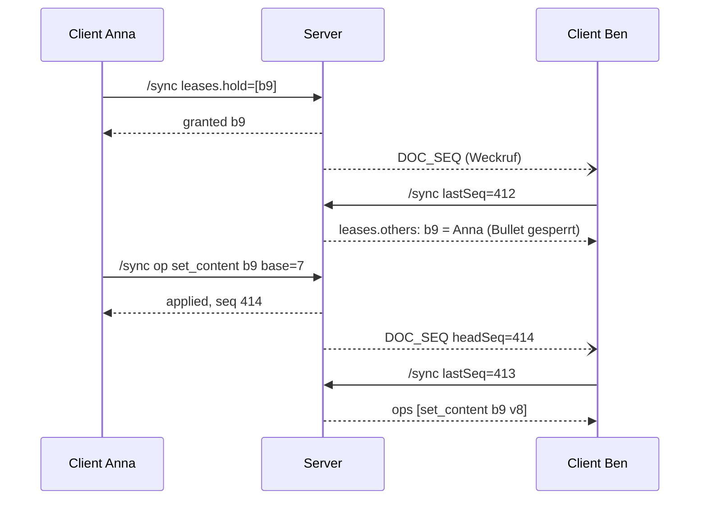

# Modul: Gemeinsames Bearbeiten von Notizen

Code: [internal/collab/](../../internal/collab/) (Regeln, ohne Datenbank), [internal/storage/docsync.go](../../internal/storage/docsync.go) (Log, Snapshot, Rollen, Verdichtung), [internal/api/docsync.go](../../internal/api/docsync.go) (Endpunkte, Hintergrundjob), [frontend/src/lib/docSync/](../../frontend/src/lib/docSync/) (Engine im Browser), Anzeige in [DocumentEditor.tsx](../../frontend/src/features/workspace/DocumentEditor.tsx), [OutlinerTree.tsx](../../frontend/src/features/workspace/OutlinerTree.tsx) und [OutlinerBlock.tsx](../../frontend/src/features/workspace/OutlinerBlock.tsx).

Mehrere Personen und Geräte bearbeiten dieselbe Notiz gleichzeitig. Jede Notiz, auch eine private, speichert über diesen Weg; es gibt keinen zweiten Speicherweg.

## Anforderungen

1. **Kein Datenverlust.** Was jemand getippt hat, steht danach in der Notiz, auch nach Verbindungsabbruch, Neuladen oder gleichzeitigem Bearbeiten desselben Bullets.
2. **Funktioniert ohne WebSocket.** Hinter Proxys, die WebSockets blocken oder Streams puffern, funktioniert die Bearbeitung voll, nur mit etwas mehr Verzögerung.
3. **Funktioniert bei schlechtem Netz.** Eingaben werden lokal gesichert und später zuverlässig übertragen, auch nach Tagen offline.
4. **Klare Regel bei Konflikten.** Bearbeiten zwei Personen denselben Bullet, bekommt eine das Recht. Der Text der anderen bleibt als Konfliktkopie erhalten.
5. **Berechtigungen.** Notizen und Ordner lassen sich als *Bearbeiter* oder *Leser* teilen; der Server prüft das bei jeder Änderung.

## Ansatz

**Server-autoritatives Operations-Log mit Versionen pro Block und Block-Sperren (Leases).** Daten fließen immer über gewöhnliche HTTP-Anfragen; WebSocket, SSE und Long-Polling sind nur der Weckruf.

| Baustein | Aufgabe |
|---|---|
| **Operations-Log** | Jede Änderung ist eine kleine Operation (Text ändern, Block einfügen, verschieben, löschen …). Der Server prüft und wendet sie an und schreibt die Auswirkungen (Effekte) mit fortlaufender Nummer `seq` pro Notiz ins Log. Wer seine `seq` kennt, holt alles danach. |
| **Version pro Block** | Jede Textänderung nennt die Blockversion, die der Nutzer beim Tippen vor sich hatte. Passt sie nicht mehr, liegt ein Konflikt vor. |
| **Lease pro Block** | Wer in einen Bullet klickt, hält ihn für 20 s und verlängert das, solange er dort arbeitet. Andere sehen „Anna bearbeitet …“ und können genau diesen Bullet so lange nicht ändern, alle anderen schon, auch im selben Ast. |
| **Konfliktkopie** | Kommt es trotzdem zum Konflikt (Lease abgelaufen, jemand war offline), behält der Block die zuerst gespeicherte Fassung; der andere Text wird als markierter Block direkt darunter eingefügt. |
| **Lokale Warteschlange** | Jede Änderung landet zuerst in IndexedDB und wird von dort gesendet. Jede Operation hat eine eindeutige ID; doppeltes Senden ist harmlos. |

### Warum nicht CRDT (Yjs/Automerge) oder OT

- **CRDT** führt Zeichen für Zeichen zusammen. Dafür bräuchte das Go-Backend eine vollständige Yjs-Implementierung, um Rechte, Hashtags und Markdown serverseitig auszuwerten; die gibt es in Go nicht ausgereift. Ohne sie wäre der Server nur ein Speicher für Binärdaten, den er nicht prüfen kann. Ein früherer Versuch ist daran gescheitert.
- **OT** braucht einen fehlerfreien Transformations-Kern für jede Operationsart; schwer korrekt zu bekommen und schwer zu testen.
- Gewollt ist, dass bei einem Bullet **einer das Recht bekommt**. Sperren plus Versionsprüfung sind einfach zu verstehen, vollständig serverseitig prüfbar und gegen Netzfehler testbar.
- Bewusster Verzicht: Zwei Personen können nicht gleichzeitig im **selben** Bullet tippen. In **verschiedenen** Bullets, auch im selben Ast, geht es.

## Datenmodell

Details in [database.md](../database.md).

- **Baum statt flacher Liste.** `blocks.parent_id` (leer = oberste Ebene) und `blocks.order_key` sortieren Geschwister. Einrücken oder Verschieben eines Astes ist *eine* Operation auf *einem* Block. Ebene und Position für die Oberfläche berechnet der Server beim Lesen.
- **Sortierschlüssel (Fractional Index).** Ein neuer Block zwischen `a0` und `a1` bekommt einen Schlüssel dazwischen; umnummeriert wird nie. Gleiche Schlüssel (zwei gleichzeitige Einfügungen) sortiert die Block-ID. Go (`orderkey.go`) und TypeScript (`orderKey.ts`) erzeugen identische Schlüssel, geprüft mit gemeinsamen Testvektoren.
- **Grabsteine.** Gelöschte Blöcke bleiben mit `deleted = 1` und `deleted_at` erhalten. Eine verspätete Textänderung stellt den Block wieder her, statt verloren zu gehen. Nach 30 Tagen werden sie endgültig entfernt (siehe [Verdichtung](#verdichtung)).
- **Log** `doc_ops` (Effekte je `seq`) und **Idempotenz** `doc_op_results` (Ergebnis je Operations-ID). Das Abspielen des Logs ab einem Snapshot ergibt exakt den Serverstand.
- **Leases und Sitzungen liegen im Arbeitsspeicher** (`collab.LeaseManager`). Sie sind kurzlebig, nach einem Neustart fordern Clients sie automatisch neu an. MindSift läuft als eine Instanz, das passt.
- **Abgeleitete Daten** (`markdown_cache`, Suchtext, `tags`, `block_tags`) entstehen in derselben Transaktion wie die Änderung.

## Protokoll

Endpunkte und Felder: [api/rest.md](../api/rest.md#gemeinsames-bearbeiten-von-notizen).

| Methode | Pfad | Zweck |
|---|---|---|
| GET | `/api/v1/docs/{id}/snapshot` | Alle Blöcke inkl. Grabsteine, Titel, `headSeq`, eigene Rolle, `shared` |
| POST | `/api/v1/docs/{id}/sync` | **Ein Aufruf für alles:** eigene Operationen senden, Leases halten, neue Log-Einträge abholen |
| GET | `/api/v1/docs/{id}/changes?since=N&wait=25` | Long-Polling: antwortet, sobald sich die Notiz (oder Sperren/Präsenz) ändert, spätestens nach `wait` Sekunden |
| POST | `/api/v1/docs/{id}/leave` | Sitzung beenden, Leases freigeben |

Operationen: `insert`, `set_content`, `set_props` (Typ, abgehakt, eingeklappt, Sprache, Konflikt erledigt), `move`, `delete`, `restore`, `set_title`. Im Log steht zusätzlich `purge` (Verdichtung).

### Regeln auf dem Server

Alle Operationen einer Notiz laufen nacheinander: ein Mutex pro Notiz und eine SQLite-Transaktion pro `/sync`. „Wer zuerst kommt“ ist dadurch immer eindeutig.

1. **Idempotenz:** Ist die Operations-ID bekannt, kommt das gespeicherte Ergebnis zurück, ohne erneut anzuwenden. Verlorene Antworten sind harmlos.
2. **Berechtigung:** Operationen nur mit Rolle `owner` oder `editor`, sonst `403`. Block-IDs anderer Notizen sind tabu.
3. **`set_content`:** Hält ein *anderer* Client eine Lease oder passt die Basisversion nicht → **Konflikt**. Gleicher Text → angewendet ohne neue Version. Gelöschter Block → wiederherstellen (bei gelöschtem Elternblock unter dem nächsten lebenden Vorfahren) und anwenden. Endgültig entfernter Block → Text wird als neuer Block am Ende angelegt.
4. **Konflikt:** Der Block behält seinen Inhalt. Direkt danach entsteht ein Block mit dem abgelehnten Text, `conflictOf` und `conflictAuthor` gesetzt, mit deterministischer ID (`blk_cf_` + Hash der Operations-ID), damit Wiederholungen keine zweite Kopie erzeugen. Für den Titel gilt dasselbe mit eigener Titelversion.
5. **`move`:** abgelehnt bei Zyklus, bei gelöschtem Ziel-Elternblock oder wenn jemand anders den Block selbst hält. Unterpunkte wandern mit; wer darin tippt, tippt einfach an der neuen Stelle weiter.
6. **`delete`:** abgelehnt, wenn jemand anders einen Block im Ast hält; sonst Grabstein für den ganzen Ast.
7. **`insert`:** Ist der Elternblock gelöscht, wird unter dem nächsten lebenden Vorfahren eingefügt, ist er endgültig entfernt, auf oberster Ebene.
8. **Leases:** Vergabe nur, wenn frei, abgelaufen oder schon im Besitz desselben Clients; gültig 20 s ab letzter Bestätigung. `leases.hold` ist immer die vollständige Liste. Neu eingefügte Blöcke und Konfliktkopien bekommt ihr Autor automatisch.
9. **Keine Lease auf Elternblöcke:** Einfügen, Ein- und Ausrücken unter einem Elternblock brauchen keine Sperre auf diesen.

### Ablauf beim Tippen

## Client (`DocSyncEngine`)

- **Zustände:** *bestätigter Stand* (vom Server, mit `lastSeq`) und *Warteschlange* (eigene, unbestätigte Operationen). Angezeigt wird der bestätigte Stand mit der Warteschlange darübergelegt; das macht `model.ts` mit denselben Regeln wie der Server.
- **Editor-Anbindung:** Die Editor-Komponenten arbeiten mit einer flachen Liste (Ebene + Reihenfolge). `diff.ts` übersetzt jede Änderung per Vergleich in Operationen.
- **Persistenz:** Warteschlange und bestätigter Stand liegen in IndexedDB. Beim Öffnen erscheint sofort der gespeicherte Stand, auch offline.
- **Senden:** gesammelt nach 300 ms, immer nur ein `/sync` gleichzeitig; Wiederholung mit Backoff 1 s, 2 s, 4 s … höchstens 30 s. Mehrere Textänderungen eines Blocks werden zusammengefasst; die Basisversion bleibt die der ersten (die der Nutzer beim Tippen sah), damit nie eine fremde Änderung überschrieben wird.
- **Leases:**
  - Tippen wartet nie auf eine Sperre. Beim Fokussieren wird sie sofort angemeldet.
  - Neue Bullets (Enter, Einfügen) gehören sofort dem Ersteller.
  - Verlassene Bullets bleiben 20 s gehalten; nach 60 s ohne Eingabe wird auch der fokussierte Bullet freigegeben.
  - Fremd gesperrte Bullets zeigen ein Schloss mit Namen und sind schreibgeschützt; Enter darin legt einen neuen Bullet darunter an. Löschen, Zusammenführen, Ein-/Ausrücken und Ziehen, die einen gesperrten Bullet berühren, werden gar nicht erst ausgeführt (Hinweis unten im Editor).
- **Konflikte:** Konfliktkopien sind farbig markiert, mit „Übernehmen“ (ersetzt den Originaltext) und „Verwerfen“. Beide prüfen vorher die Sperren von Original und Kopie.
- **Hintergrund und Netz:** Beim Verbergen der Seite sendet die Engine Ausstehendes mit `keepalive` und gibt ihre Sperren frei; bei `online` und Rückkehr in den Tab gleicht sie sofort ab.
- **Rechteentzug:** Der nächste `/sync` liefert `403` bzw. `404`. Die Engine verwirft die Warteschlange nicht, hört aber auf zu senden und zeigt den Fehler.
- **Neu laden:** Meldet der Server `resync` (Client voraus oder hinter der verdichteten Log-Grenze) oder fehlt eine `seq`, lädt die Engine den Snapshot; die Warteschlange bleibt erhalten und wird danach angewendet.

## Transport: robust auch hinter Proxys

Daten fließen nur über `/sync` und `/snapshot`. Push-Kanäle melden nur „Notiz X hat jetzt `headSeq` N“ (`DOC_SEQ` im Raum `doc:<id>`, siehe [api/websocket.md](../api/websocket.md)).

| Stufe | Ausfall erkannt durch | Wechsel zu |
|---|---|---|
| 1. WebSocket | Verbindungsfehler oder 35 s ohne `PONG` auf das `PING` alle 15 s (WebSocket angenommen, aber nichts kommt durch) | SSE |
| 2. SSE | Erstes Ereignis kommt nicht innerhalb von 5 s (Proxy puffert); gilt dann für den ganzen Tab | Long-Polling |
| 3. Long-Polling: app-weit (`/events/poll`, `DOC_SEQ` wie bei SSE), sonst eigenes (`/changes`, 25 s) | 3 Fehlschläge hintereinander | Intervall |
| 4. Intervall | – | Abfrage alle 3 s; bei `online` wird Long-Polling erneut versucht |

Zusätzlich, solange Stufe 1–3 läuft: Abgleich alle 7 s, wenn die Engine Sperren hält (Verlängerung), sonst alle 30 s zur Sicherheit. Der Editor zeigt den Weg an („Live“, „Live (Long-Polling)“, „Abgleich alle 3 s“). Gemessen im Browser-Test: 0,2–0,3 s über WebSocket, SSE und Long-Polling, rund 3 s im Intervall.

Long-Polling bleibt mit 25 s unter üblichen Proxy-Grenzen (Nginx 60 s, Cloudflare 100 s). Den Schreib-Timeout hebt der Server für Streams und Long-Polling auf. Räume betritt nur, wer die Notiz lesen darf. Proxy-Beispiele: [reverse-proxy.md](../reverse-proxy.md).

## Berechtigungen

- Rollen je Notiz: `owner`, `editor`, `viewer`. Die effektive Rolle ist die höchste aus Eigentum, direkter Freigabe, Gruppenfreigabe und Freigabe des geteilten Ordners. Eine zentrale Funktion `Store.DocRole` entscheidet für Snapshot, Sync, Long-Polling, Raumbeitritt und Aufgaben-Verknüpfungen.
- Nur der Eigentümer verwaltet Freigaben und löscht die Notiz. Bearbeiter dürfen sonst alles: Inhalt, Struktur, Titel und Symbol.
- Freigaben liegen in `doc_shares`, `doc_team_shares` und `workspace_folder_shares` (`read`/`write`). Eine Zusammenlegung zu einer Tabelle wurde bewusst nicht umgesetzt: `DocRole` entscheidet bereits zentral, das Umschreiben der rund 20 Sichtbarkeitsabfragen brächte nur Risiko. Mehr: [sharing-and-permissions.md](../sharing-and-permissions.md).

## Private Notizen

Gleiches Modell, aber sparsam: Solange eine Notiz nicht geteilt ist (`shared = false`) und nur in einem Tab offen ist (`sessions = 1`), gibt es keine Leases, keinen Herzschlag und nur die 30-s-Abfrage. Öffnet ein zweites Gerät die Notiz oder wird sie geteilt, schalten alle offenen Clients mit der nächsten Antwort auf den vollen Ablauf um. Gegenüber dem früheren Speichern des ganzen Dokuments alle 800 ms überträgt und schreibt das Modell nur geänderte Blöcke.

## Rückgängig und Wiederholen

- `Strg+Z`/`Cmd+Z` nimmt die letzte **eigene** Änderung zurück, `Strg+Umschalt+Z` bzw. `Strg+Y` wiederholt. Fremde Änderungen bleiben unberührt.
- Zu jeder eigenen Änderung merkt sich die Engine den Gegenschritt (`undo.ts`) und sendet ihn als normale Operation; Server und Log brauchen dafür nichts Besonderes.
- Tippen im selben Bullet ist ein Schritt bis zu einer Pause von 1 s; Einfügen, Löschen, Einrücken, Verschieben, Abhaken und mehrzeiliges Einfügen sind jeweils ein Schritt. Bis zu 200 Schritte pro Tab und Notiz.
- Hat inzwischen jemand anders den Bullet geändert oder hält ihn gerade, wird der Schritt mit Hinweis übersprungen, nie blind überschrieben.
- Das Undo des Textfelds selbst wird abgefangen (`keydown` und `beforeinput` mit `historyUndo`), damit Browser-Undo und eigenes Undo nicht gegeneinander arbeiten.

## Verdichtung

Ein Hintergrundjob (`startCompaction`) läuft beim Start und danach alle 6 Stunden:

| Was | Aufbewahrung |
|---|---|
| Log geteilter Notizen | 30 Tage; die Grenze steht in `documents.log_floor` |
| Log privater Notizen | 7 Tage |
| Grabsteine | 30 Tage nach `deleted_at`, dann endgültig entfernt per Log-Eintrag `purge` (offene Editoren übernehmen das ohne Neuladen) |
| Idempotenz-Ergebnisse | 90 Tage |
| Leases und Sitzungen im Speicher | abgelaufene werden entfernt |

Clients hinter der Grenze laden den Snapshot neu und behalten ihre Warteschlange. Grenzen dieses Vorgehens: Nach 30 Tagen sind gelöschte Blöcke endgültig weg, Rückgängig ist dann nicht mehr möglich. Text, der so lange offline in einem inzwischen gelöschten Block getippt wurde, kommt als neuer Block ans Ende der Notiz. Wer eine Operation erst nach mehr als 90 Tagen erneut sendet, wird nicht mehr als Wiederholung erkannt; Textänderungen erzeugen dann höchstens eine Konfliktkopie.

## Tests

| Ebene | Was | Wo |
|---|---|---|
| Regeln | Konfliktmatrix aus Lease, Version, Grabstein, Verschieben, Löschen, Purge | `internal/collab/ops_test.go` |
| Simulation | 4 Clients, 25 Seeds × 600 Schritte über ein Netz, das Anfragen und Antworten verliert und verdoppelt; Clients gehen offline; zwischendurch Verdichtung. Geprüft: Konvergenz, gültiger Baum, jede Operation genau einmal angewendet, kein Text verloren. Per Gegenprobe (absichtlich eingebaute Fehler) abgesichert. | `internal/storage/docsync_sim_test.go` |
| Speicher und API | Log ↔ Snapshot, Rollen, Long-Polling, Verdichtung | `internal/storage/docsync_test.go`, `internal/api/docsync_test.go` |
| Browser-Engine | Vitest mit gefälschtem Server und Netz, `fake-indexeddb`: offline, Neuladen, verlorene Antworten, Push-Wechsel, Verdichtung | `frontend/src/lib/docSync/__tests__/` |
| Ende-zu-Ende | Playwright mit zwei Benutzern: gemeinsames Tippen, Freigabe, Sperren, Konflikte, Undo, alle Transport-Stufen mit blockiertem WebSocket/SSE | `e2e/` (`e2e/run.sh`) |
