<div align="center">

# 🧠 MindSift
### *A clear head in three seconds.*

[](#-quick-start)
[](#-quick-start)
[](LICENSE)
[](CHANGELOG.md)

**Dump a thought, sort it later, turn it into a task, a note or a shopping list, alone or together.**
Self-hosted, one container, one SQLite file, your server.

### [▶ Try the live demo](https://demo.mindsift.app) &nbsp;·&nbsp; [🌐 Website](https://mindsift.app/en/) &nbsp;·&nbsp; [🚀 Quick start](#-quick-start)

<sub>Demo login: <code>admin</code> / <code>admin</code> (or <code>user</code> / <code>user</code> in a second window to see live collaboration). It resets every 20 minutes, so break whatever you like.</sub>

<p align="center">
  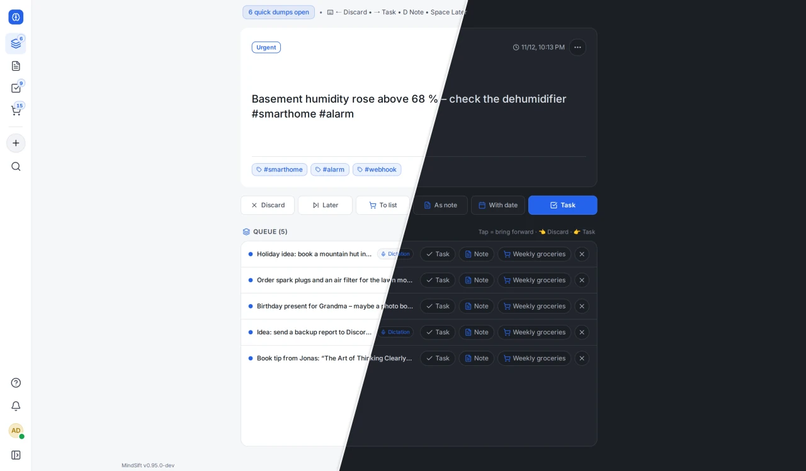
</p>

</div>

---

> ### 👋 Hey, before you scroll
>
> Yes, this was coded with a *lot* of AI help. No, that doesn't make it slop. I've put many, many evenings into it: deciding what goes in and what doesn't, testing every screen on my phone on the bus, ripping things out again and nitpicking pixels until it felt right. The robot typed, I argued with it.
>
> Credit where it's due: none of this came out of thin air. The idea is a remix of every outliner, kanban board and shopping list app I've ever loved (and a few I rage-quit), and the code stands on the shoulders of thousands of open-source developers whose work taught the models how to write it. So really, this is a big thank-you note with a login screen. 🙏
>
> It's free, and it stays free. Use it, fork it, host it for your family. If something's broken, open an issue. If you like it, a ⭐ makes my day. And if you hate it… please don't. Just close the tab. 😅

---

## 💡 The idea

Most notes and task apps demand structure at the wrong moment. When a thought pops up, you don't want to pick a folder or fill in fields. MindSift separates **capturing** from **organizing**:

1. **Dump:** type into the bar, hit `Enter`, done. Or hold the `+` on your phone and just talk.
2. **Sort (triage):** later, go through the pile card by card: discard, make it a task, turn it into a note or a list item. One key or one swipe each.
3. **Go deeper:** loose ideas grow into tasks with subtasks, linked outliner notes or lists you share with your family or team.

The [website](https://mindsift.app/en/) shows all of this with little interactive demos. Even better: [click around in the real thing](https://demo.mindsift.app).

---

## ✨ What's inside

### ⚡ Quick dump & triage
Capture from anywhere: the input bar (`C` or `/`), voice input (in the browser or through your own Whisper server, so nothing leaves your network), the share menu of your phone, or the API. Then sort it in the triage deck with the keyboard (`H`/`L`, arrows) or by swiping.

<p align="center">
  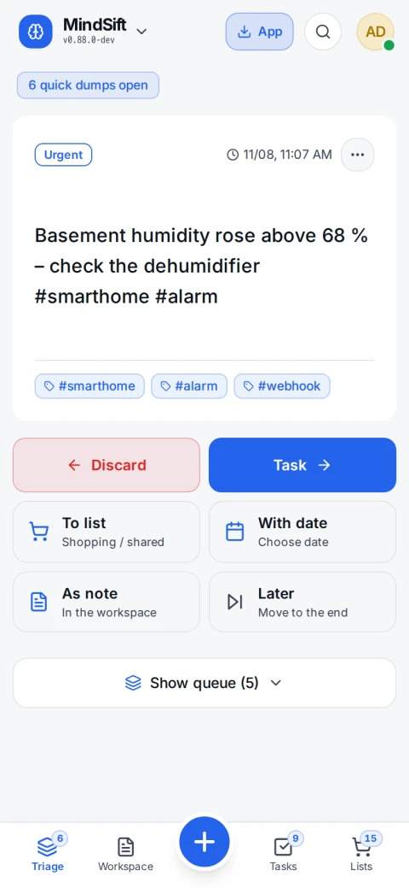
  &nbsp;&nbsp;
  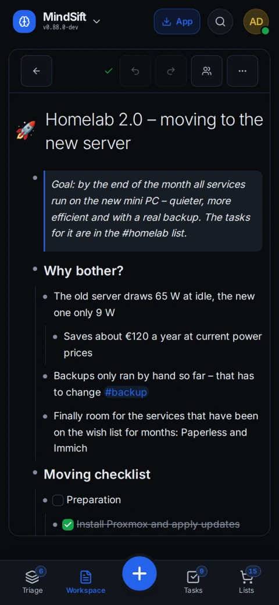
</p>

### ✅ Tasks & kanban
List and board view with your own columns, priorities, due dates, subtasks, recurring tasks, drag & drop and undo. Share task lists, watch tasks, and get alarms and a daily summary by email, push, Discord or webhook.

<p align="center">
  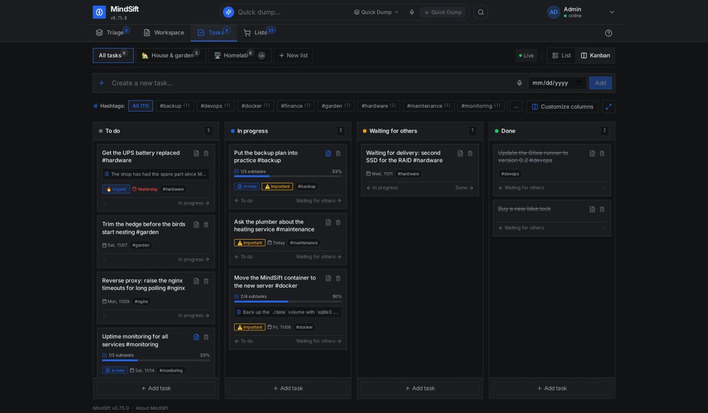
</p>

### 📝 Outliner notes, together, live
Every thought is a bullet: indent, collapse, zoom in, drag whole branches. Wiki links (even to single bullets), hashtags, slash commands, code blocks, images, voice notes, live dictation and link previews. Several people write in the same note at the same time, without overwriting each other, and it keeps working offline and behind strict proxies.

<p align="center">
  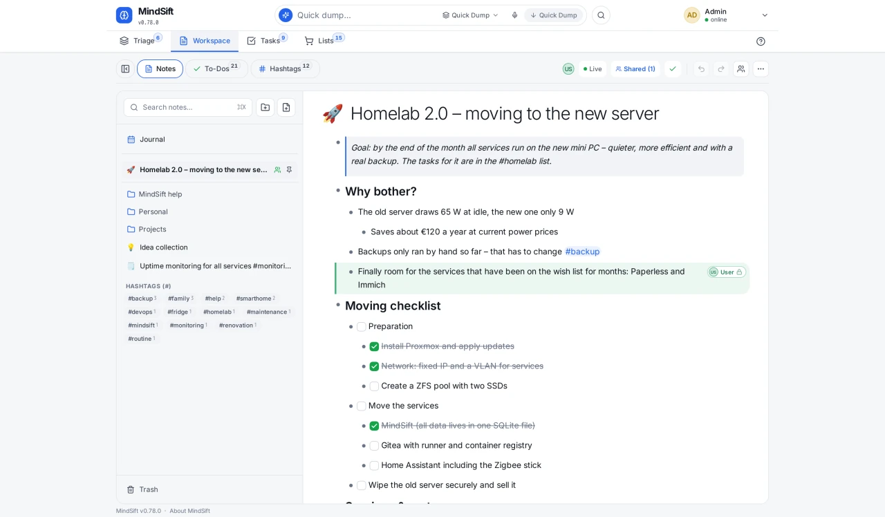
</p>

### 📅 Journal
One note per day, all days below each other, with a calendar to jump around.

<p align="center">
  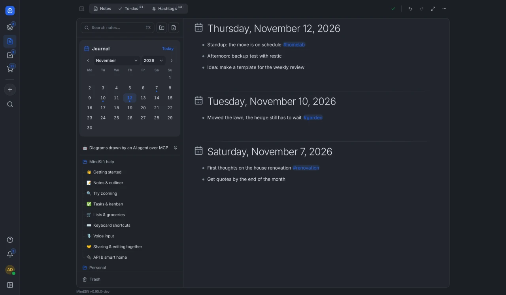
</p>

### 🛒 Shared lists
Shopping, packing and checklists with categories by hashtag (`oat milk #fridge`) and quantities. Tick something off at the supermarket and it's gone on everyone's phone right away.

<p align="center">
  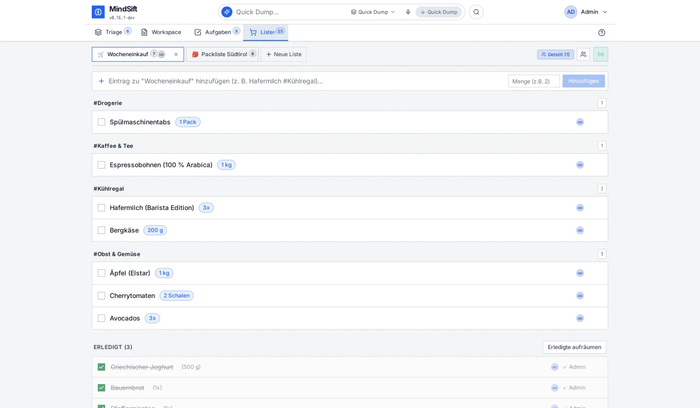
</p>

### 🎨 Looks & app
Five colour families, each light and dark, your own accent colour, round or square corners, plus a theme manager for your own CSS. Installable as an app (PWA) on phone and desktop, starts offline, with push notifications. Speaks English, German, Spanish, French and Italian, mails and notifications included.

<table>
  <tr>
    <td align="center">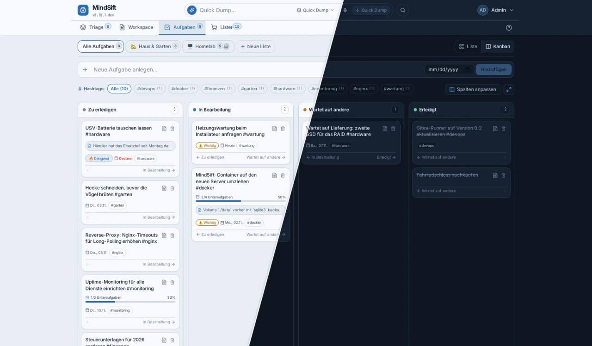<br /><sub><b>Fjord</b></sub></td>
    <td align="center">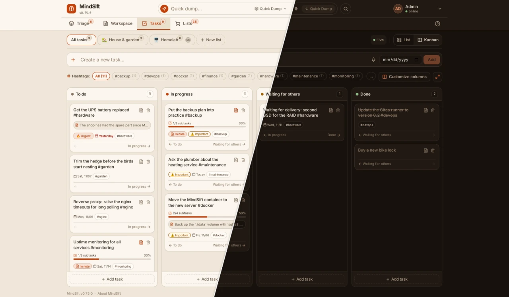<br /><sub><b>Terracotta</b></sub></td>
  </tr>
  <tr>
    <td align="center">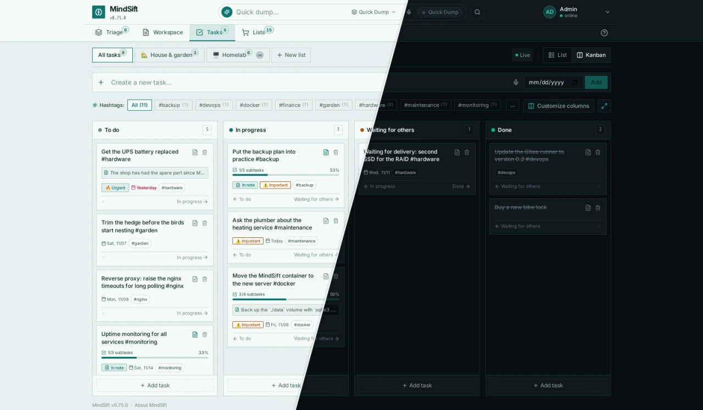<br /><sub><b>Polarized</b></sub></td>
    <td align="center">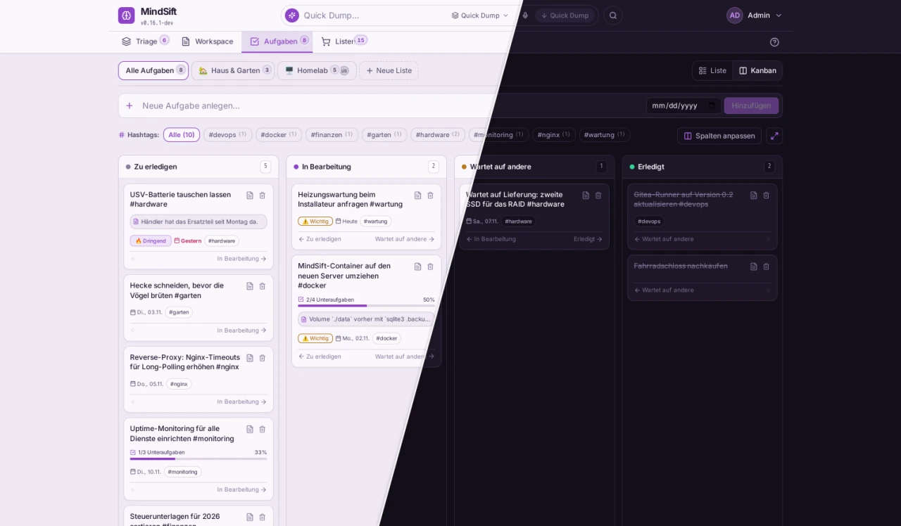<br /><sub><b>Suri</b></sub></td>
  </tr>
</table>

### 🤖 AI agents, API & smart home
MindSift is an **MCP server**: Claude, ChatGPT, Codex, Cursor and your own agents can read and manage your tasks, lists and notes. claude.ai and ChatGPT connect via OAuth, no key needed. A REST API with scoped keys covers Home Assistant sensors, curl scripts and webhooks. Whatever a key creates or changes carries a badge with its name, so you always know what the robot did.

```bash
claude mcp add --transport http mindsift https://your-server/api/v1/mcp --header "X-API-Key: mindsift_sec_…"
```

### 🏢 Users & admin
Guided first-time setup, invite codes and links, registration modes (closed, approval, email domains, open), groups, sharing as editor or read-only, automatic backups and restore.

👉 **The full feature tour lives on the [website](https://mindsift.app/en/). Or just [open the demo](https://demo.mindsift.app) and poke around.**

---

## 🚀 Quick start

MindSift is a single container with web server, API, database and frontend.

**Install script:**

```bash
curl -fsSL https://raw.githubusercontent.com/mindsift-app/mindsift/main/install.sh | bash
```

It creates a folder, downloads `docker-compose.yml` and `.env.example`, generates a `JWT_SECRET` and starts the container.

**Or Docker Compose by hand:**

```yaml
services:
  mindsift:
    image: ghcr.io/mindsift-app/mindsift:latest   # :latest = every release, :dev = development
    restart: unless-stopped
    ports: ["8080:8080"]
    volumes: ["./data:/data"]
    environment:
      - JWT_SECRET=put-a-long-random-value-here
      - BASE_URL=https://mindsift.example.com
```

Open `http://localhost:8080` and a wizard creates the admin account. Do that right after the first start, so nobody else grabs it.

All settings are explained in [`.env.example`](.env.example). Optional voice recognition: uncomment the `whisper` block in [`docker-compose.yml`](docker-compose.yml) and set `STT_URL=http://whisper:8000`.

---

## ⚙️ Running it

The most important settings (all of them, with explanations, are in [`.env.example`](.env.example)):

| Variable | Default | What for |
|---|---|---|
| `JWT_SECRET` | generated (`/data/jwt.secret`) | Signing key for sign-in tokens; better set your own long random value |
| `BASE_URL` | `http://localhost:8080` | Public URL; needed for password reset mails, OAuth for claude.ai/ChatGPT and links in mails |
| `DEFAULT_LANGUAGE` | `de` (demo: `en`) | Default language (`de`, `en`, `es`, `fr`, `it`) until an admin or the setup wizard picks one; everyone can choose their own |
| `TZ` | `Europe/Berlin` | Time zone for due dates and alarms |
| `REGISTRATION_MODE` | admin UI decides | `closed`, `approval`, `domain`, `domain+approval` or `open` |
| `SMTP_HOST`, `SMTP_PORT`, `SMTP_USER`, `SMTP_PASS`, `SMTP_FROM` | empty | Mail for alarms, invites and password reset (also in the admin UI) |
| `TRUSTED_PROXIES` | `private` | Whose `X-Forwarded-For` to trust, see [reverse proxy](Doku/reverse-proxy.md) |
| `MCP_ENABLED` | admin UI decides | `false` switches off the endpoint for AI agents |
| `STT_*` | empty | Your own Whisper server for voice input, see [architecture](Doku/architecture.md#speech-recognition) |
| `MINDA_DEMO` | `false` | Demo accounts `admin/admin` and `user/user` with sample data. **Never on a public server with real data!** |

* **Reverse proxy:** pass through WebSocket upgrades and unbuffered SSE if you can. If not, MindSift falls back to long polling by itself. Examples for nginx, Traefik, Caddy and Cloudflare: [Doku/reverse-proxy.md](Doku/reverse-proxy.md).
* **Backups:** switch on daily backups in the admin settings (whole database plus one per user under `data/backups/`). Copy that folder somewhere else too.
* **Updates:** `docker compose pull && docker compose up -d`. The database schema updates itself; open apps offer to reload.
* **Image tags:** `:latest` = every release from `main`, `:dev` = development, `:vX.Y.Z` and `:stable` for tagged releases.
* **What changed:** [CHANGELOG.md](CHANGELOG.md).

---

## 🔒 Your data is yours

No telemetry, no third-party services, fonts and icons ship with the app. The server only connects out for what you use: notifications (SMTP, Discord, your webhook, the browsers' push services), link previews (switchable per device) and your own Whisper server. Everything lives in one SQLite file, media next to it in `data/media/`. Export the whole workspace as an Obsidian-compatible Markdown archive, or your data as a backup ZIP, whenever you want.

---

## 🛠 Development

Go 1.23 and Node 22.

```bash
go vet ./... && go test ./...      # backend
cd frontend && npm ci
npm run dev                        # Vite dev server
npx tsc --noEmit && npm run test:run
cd .. && e2e/run.sh                # browser tests (Playwright) against a fresh image
e2e/screenshots.sh                 # recreate the screenshots in this README
```

The multi-stage `Dockerfile` builds the frontend, embeds it into the Go binary and runs all checks. **Stack:** Go (chi, gorilla/websocket, modernc SQLite) · React 18, TypeScript, Vite, Tailwind.

Technical documentation: [Doku/](Doku/README.md) (architecture, database, REST and realtime API, collaboration, permissions, themes). Known weak spots: [Doku/flaws.md](Doku/flaws.md).

---

## 📄 License

MindSift is free software under the [GNU Affero General Public License v3.0](LICENSE): use it, change it, pass it on, even commercially. If you hand out a changed version or run it as a service on the net, its source has to be available under the same license. No warranty.

<div align="center">

**[▶ Try the demo](https://demo.mindsift.app)** · **[🌐 mindsift.app](https://mindsift.app/en/)**

<sub>Built for clarity, speed and owning your own stuff. With love, stolen ideas and a robot.</sub>

</div>
