<div align="center">

# 🧠 MindSift
### *Notes, tasks and a clear head, self-hosted.*

[](#quick-start)
[](#quick-start)
[](LICENSE)
[](CHANGELOG.md)

**Nested notes you write together, tasks with a board and a calendar, shared lists, and an inbox for everything that has no place yet.**
One container, one SQLite file, your server.

### [Try the live demo](https://demo.mindsift.app) &nbsp;·&nbsp; [Website](https://mindsift.app/en/) &nbsp;·&nbsp; [Quick start](#quick-start)

<sub>Demo login: <code>admin</code> / <code>admin</code> (or <code>user</code> / <code>user</code> in a second window to see live collaboration). It resets every 20 minutes, so break whatever you like. The demo runs the current development build (`:dev`), so it may show features that are not in the latest release yet, and bugs that are not fixed yet.</sub>

<p align="center">
  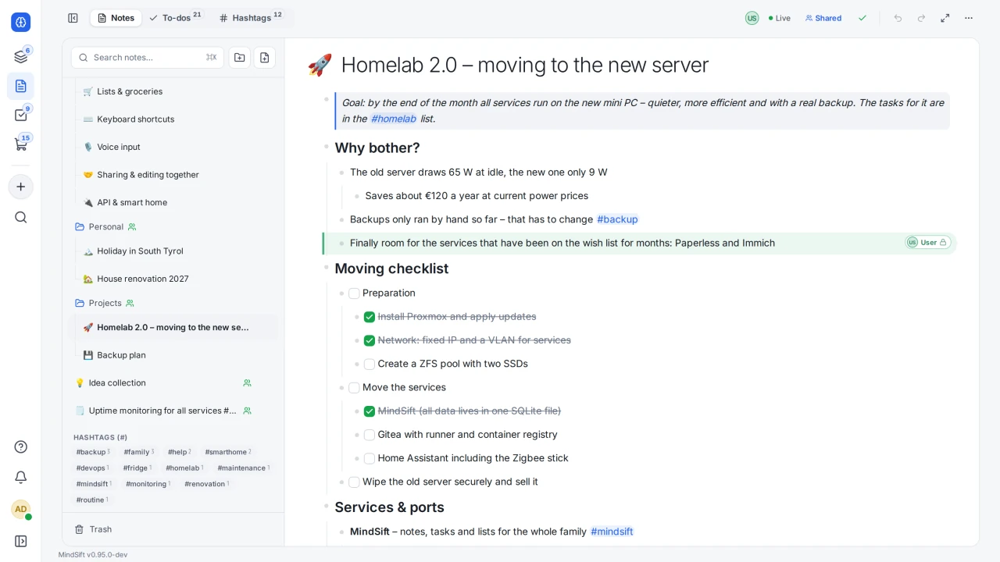
</p>

</div>

---

> ### 👋 A personal note before you scroll
>
> MindSift is built with a lot of help from AI. I want to be open about that. AI wrote a large part of the code, but it didn't decide what MindSift should become, how its architecture should work, or what makes a feature good enough to ship.
>
> I'm a trained IT specialist with a background in systems integration, infrastructure and software development. I've worked with Linux, networking, Kubernetes and web applications long before AI coding tools became part of my workflow.
>
> I use AI as a development tool, not as a substitute for engineering. I make the architectural decisions, define requirements, challenge the generated solutions, investigate problems and take responsibility for the result.
>
> And I've put a lot of work into making sure that result is actually good. MindSift has gone through extensive functional, security and performance testing. Its codebase is regularly checked, complex browser workflows are tested, and even its performance under heavy concurrent load has been measured on surprisingly modest hardware.
>
> This isn't a project where I asked an AI to build an app and called it a day. It's a product I use myself, continuously improve and intend to maintain.
>
> I'm not claiming MindSift is perfect or vulnerability-free. Software never is. But I do care deeply about getting things right, being transparent about limitations and fixing problems when they show up.
>
> So yes, there's a lot of AI in here. But there's also a lot of engineering, testing, late nights and personal responsibility behind it.
>
> **Thanks for taking a look at MindSift. I hope you enjoy using it as much as I enjoy building it.** ❤️

---

## What's inside

### 📝 Outliner notes, together, live
Every thought is a bullet: indent, collapse, zoom in, drag a bullet on its own or, collapsed, with its whole branch. Wiki links (also to single bullets, and they survive renaming or moving a note), hashtags, slash commands, code blocks, tables, images, voice notes, dictation, link previews and hidden values (`/hidden` to keep values like passwords off the screen and out of shared or public notes: stored encrypted, shown only on a tap, never to API keys or AI agents; not a password manager). Several people write in the same note at once without overwriting each other, offline and behind strict proxies too. A public link shows a note to outsiders: read only, optionally with a password, always expiring, kept out of search engines.

Templates: mark any note you can read as one of your templates, then `/template` (`/vorlage`) inserts its bullets at the cursor and "New note" can start from it, with `{{date}}` and `{{title}}` filled in.

Drawings in a note (`/canvas`): shapes, arrows that dock to them, text and freehand; several people can draw in one drawing at once and see each other's pointers, others watch live; AI agents can draw flowcharts, mind maps, sequence and state diagrams and Git graphs from Mermaid. Focus mode hides everything but the note.

<p align="center">
  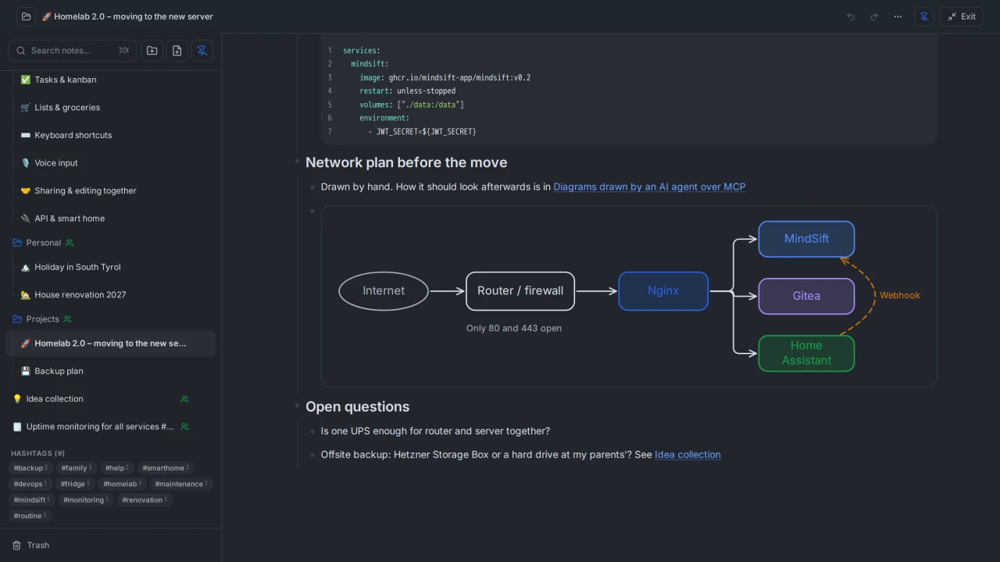
</p>

### ✅ Tasks, kanban & calendar
List, board and calendar (month or week, with a column of unscheduled tasks to drag onto a day), with your own columns, priorities, due dates, subtasks, recurring tasks and undo. Share task lists, mention people with @, watch tasks or mute a busy list, and get alarms and a daily summary by email, push, Discord or webhook.

Subscribe to your open tasks in Google Calendar, Apple Calendar, Thunderbird or Outlook through a secret link (read-only iCalendar feed).

A to-do in a note can be kept as a full task with due date, column and alarm; checkmark, title and subtasks stay in sync in both places. "Expand as a note" gives a task a note of its own, and the "To-dos" tab collects the open checkboxes of all your notes.

<p align="center">
  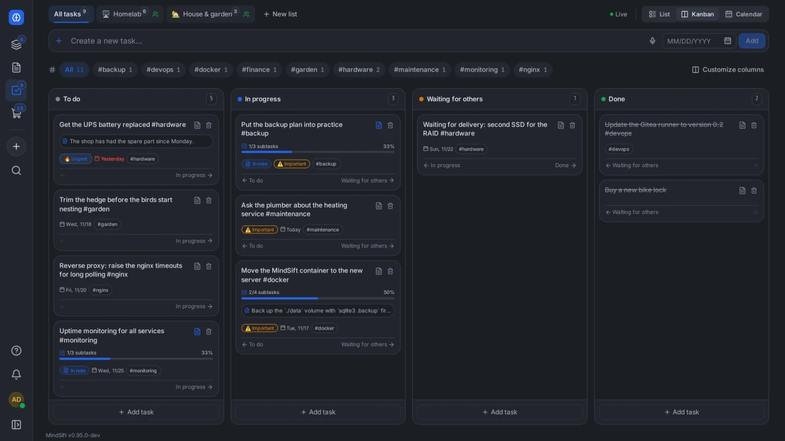
</p>

<p align="center">
  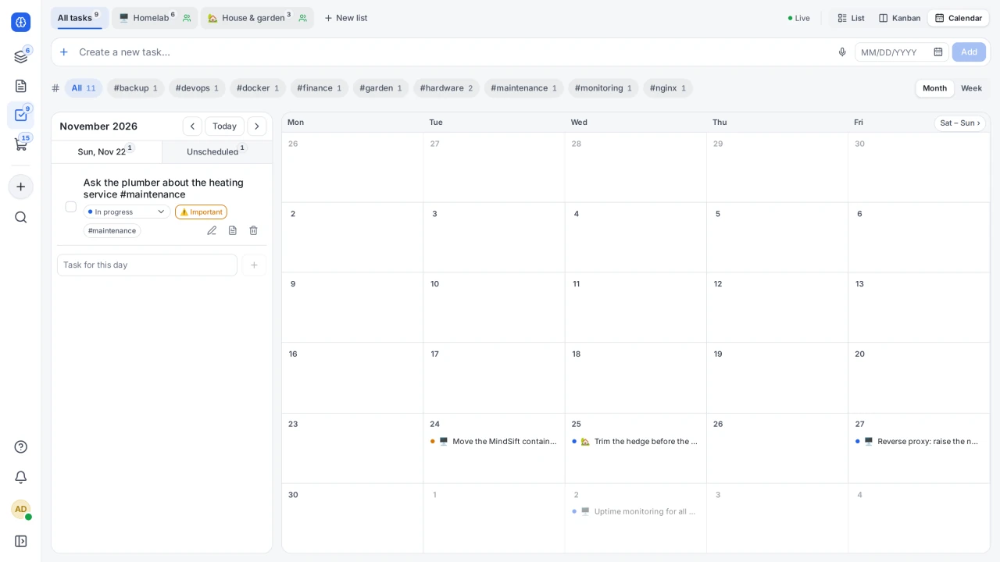
</p>

### 📅 Journal
One note per day, all days below each other, with a calendar to jump around (dots mark the days you wrote on). Every day is an ordinary note you can share, search and link to; empty days disappear by themselves. It can be switched off per device.

<p align="center">
  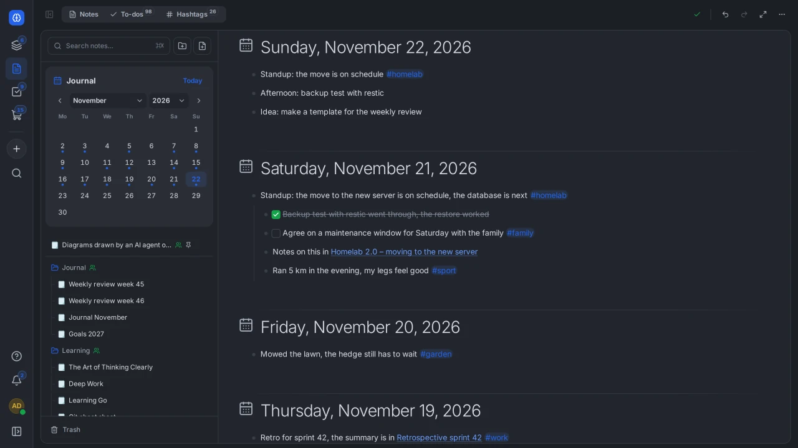
</p>

### 🛒 Shared lists
Shopping, packing and checklists with quantities and categories by hashtag (`oat milk #fridge`). Tick something off at the supermarket and it's gone on everyone's phone right away. While you type a new item, the list suggests what you have added to it before.

<p align="center">
  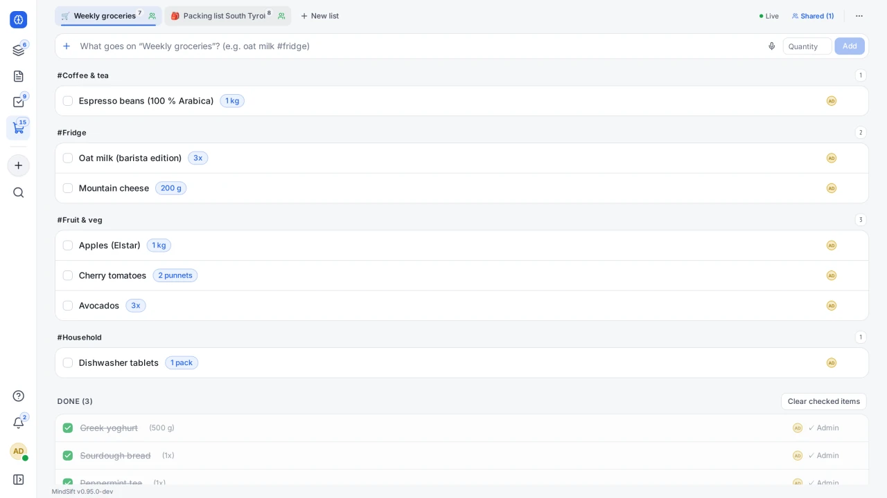
</p>

### ⚡ Quick capture & triage
Capture a thought without picking a folder: the Quick Dump window (`C`, or the + in the sidebar or on the phone), voice input (in the browser or through your own Whisper server), your phone's share menu or the API. Write a due date into the text ("dentist tomorrow 2pm") and it is recognised while you type, without AI. Everything lands in an inbox, and the swipe-style triage empties it later, one card at a time: a key (`H`/`L`, arrows) or a swipe discards a card or turns it into a task, a note or a list item.

<p align="center">
  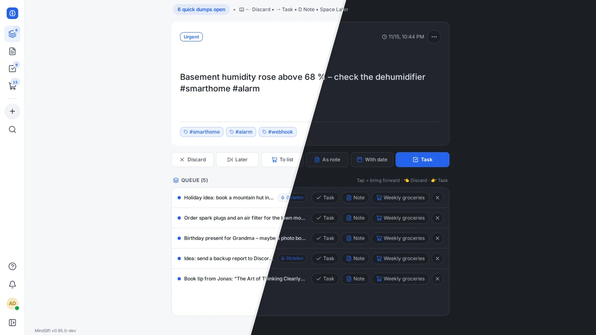
</p>

### 🎨 Looks & app
Five colour families, each light and dark, your own accent colour, round or square corners, and your own CSS in the theme manager. Installable as an app (PWA) on phone and desktop, starts offline, with push notifications. In English, German, Spanish, French and Italian, mails and notifications included.

<p align="center">
  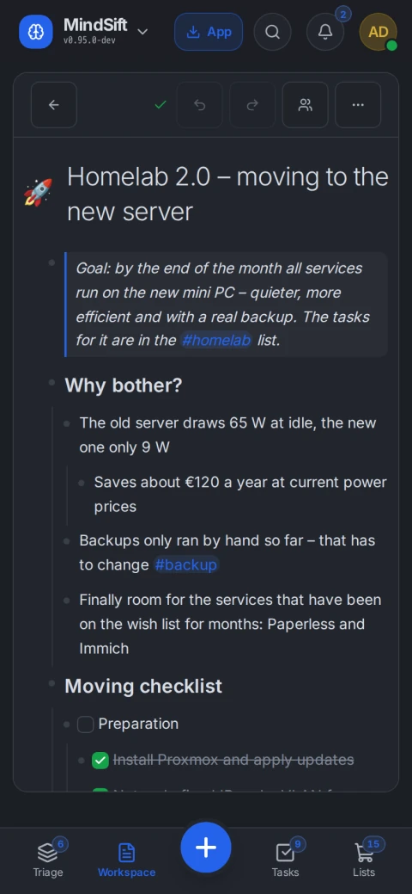
  &nbsp;&nbsp;
  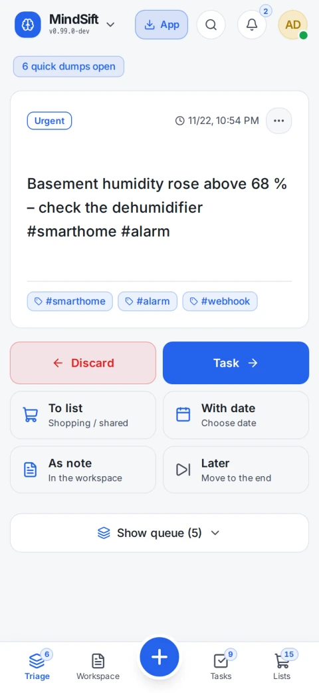
</p>

<table>
  <tr>
    <td align="center">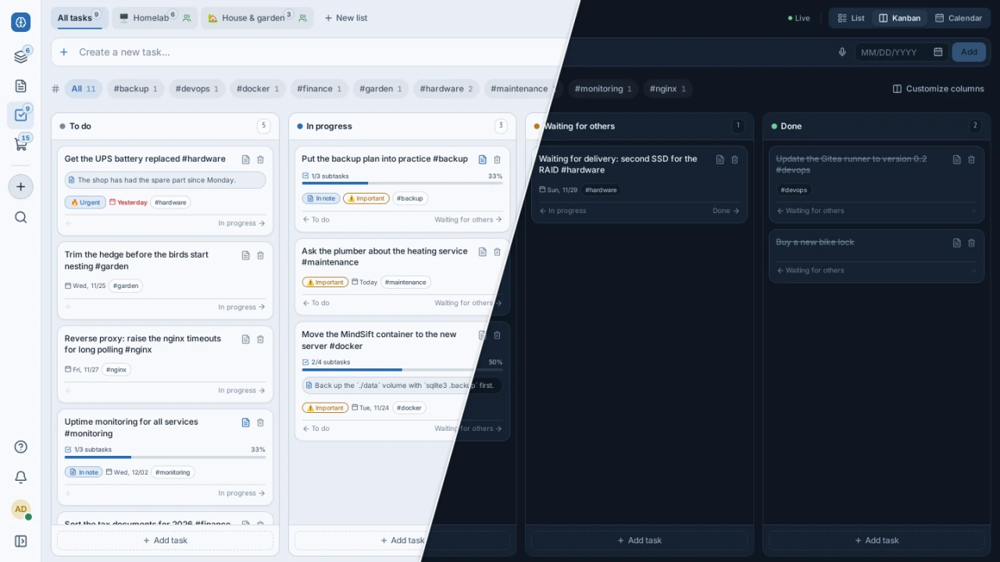<br /><sub><b>Fjord</b></sub></td>
    <td align="center">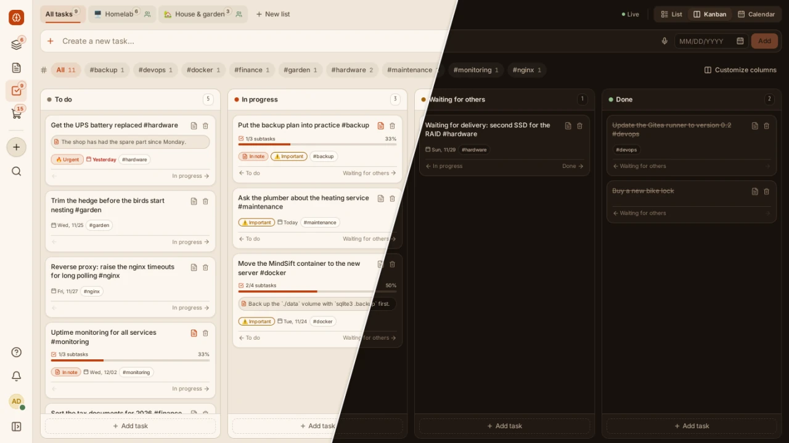<br /><sub><b>Terracotta</b></sub></td>
  </tr>
  <tr>
    <td align="center">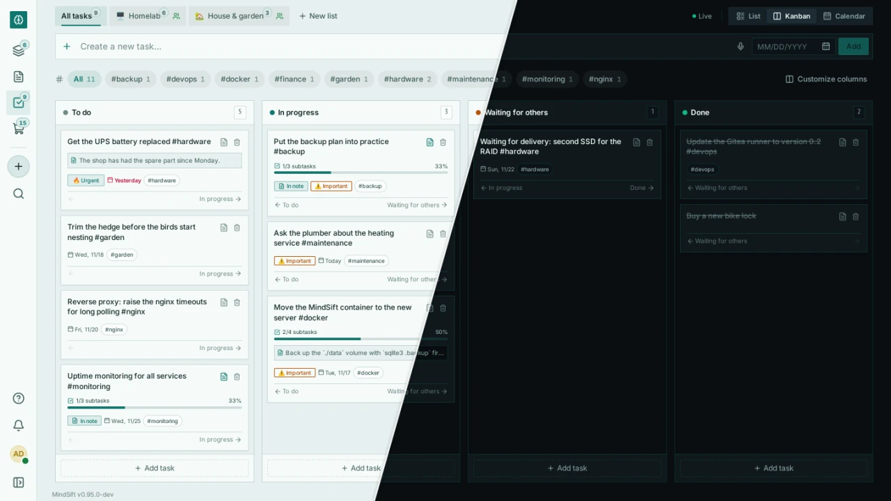<br /><sub><b>Polarized</b></sub></td>
    <td align="center">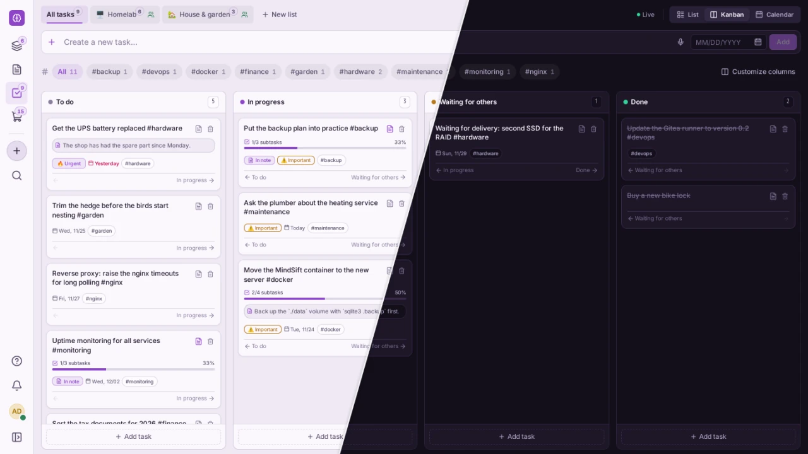<br /><sub><b>Suri</b></sub></td>
  </tr>
</table>

### 🤖 AI agents, API & smart home
MindSift is an **MCP server**: Claude, ChatGPT, Codex, Cursor and your own agents can read and manage your tasks, lists and notes. claude.ai and ChatGPT connect via OAuth, no key needed. A REST API with scoped keys serves Home Assistant, scripts and webhooks. Whatever a key creates or changes carries a badge with its name, so you can tell what an agent did.

```bash
claude mcp add --transport http mindsift https://your-server/api/v1/mcp --header "X-API-Key: mindsift_sec_…"
```

### 🏢 Users & admin
Guided setup, sign-in through Authentik, Authelia, Keycloak or any other OpenID Connect provider, invite codes and links, registration modes (closed, approval, email domains, open), organizations that decide who may share with whom (a person can be in several), groups, sharing as editor or read-only, a user manager role for accounts without the server settings, an audit log of who changed accounts, roles and settings, and automatic backups with restore.

**More on the [website](https://mindsift.app/en/), or [open the demo](https://demo.mindsift.app) and poke around.**

---

## How it compares

MindSift sits between a notes app and a task manager. If one of these fits you better, use it; they are good.

* **[Obsidian](https://obsidian.md):** Markdown files on your own disk, native apps and a huge plugin ecosystem. It is an app, not a server: no web version, and writing in the same note at the same time is not built in. MindSift is a server with a web app; it keeps notes in a database and exports them as Markdown (an Obsidian vault) whenever you ask.
* **[Logseq](https://logseq.com):** the closest relative on the notes side, a local-first outliner with backlinks, queries, a graph view and plugins, and much deeper there than MindSift. MindSift's outliner is simpler, but it runs on your server, is shared with other people and comes with tasks, lists and alarms.
* **[Vikunja](https://vikunja.io):** the more complete self-hosted task manager, with Gantt and table views, CalDAV and a choice of databases, but no notes. MindSift's tasks are tied to notes, with fewer integrations.
* **[Joplin](https://joplinapp.org):** a mature notes app with native apps everywhere, end-to-end encryption and a web clipper. A note is one Markdown document rather than an outline, and two people do not write in it at the same moment. MindSift has none of those three strengths; it has live collaboration and tasks.

If something here is out of date or unfair, please open an issue.

---

## Not in MindSift

Left out on purpose, each for a reason:

* **SAML and LDAP:** single sign-on is OpenID Connect only. Providers such as Authentik, Keycloak or Entra ID speak it and connect your LDAP or Active Directory, so MindSift does not have to.
* **Time zones per person:** one time zone per server (Administration → Server, or `TZ`); reminders, the daily summary and due dates all follow it. Ask if you need more.
* **PostgreSQL or MySQL:** SQLite on purpose (see [design decisions](#design-decisions)).
* **Backups to S3, WebDAV or SFTP:** backups go to `data/backups/`, where the administration restores them with one click. Copying them elsewhere belongs to the backup you run for the whole server, not to each app.
* **A Helm chart:** it is a single container with one volume; Docker Compose, or a small Kubernetes manifest of your own, is all it takes.
* **End-to-end encryption:** the server reads your data, because search, sharing and AI agents need it; only hidden values (`/hidden`) are encrypted in the database. Protect the server and its disk.
* **Native apps:** it is a PWA (installable, offline, push), not in the app stores.
* **Two-way calendar sync (CalDAV):** tasks are edited in MindSift.

More ideas and the known weak spots: [Doku/flaws.md](Doku/flaws.md).

---

## Quick start

One container with web server, API, database and frontend, for amd64 and arm64 (also a Raspberry Pi with a 64-bit system, Apple Silicon and ARM cloud servers).

**Docker Compose:**

```yaml
services:
  mindsift:
    image: ghcr.io/mindsift-app/mindsift:stable   # the latest tagged release
    container_name: mindsift
    restart: unless-stopped
    ports: ["8080:8080"]
    volumes: ["./data:/data"]
    environment:
      - BASE_URL=https://mindsift.example.com
      # Optional: create the admin on the first start instead of in the setup wizard
      # - ADMIN_USER=admin
      # - ADMIN_PASSWORD=...
```

Open `http://localhost:8080`. Without `ADMIN_USER` and `ADMIN_PASSWORD`, a setup wizard creates the admin account. It asks for a one-time setup code that MindSift writes to its log on start (`docker logs mindsift | grep 'Setup code'`; in the compose folder `docker compose logs mindsift` works too), so only someone who can read the server's log becomes its admin; a restart makes a new code, and it stops working once the admin exists.

**Or the install script** ([read it first](install.sh)):

```bash
curl -fsSL https://raw.githubusercontent.com/mindsift-app/mindsift/main/install.sh | bash
```

It generates the secrets, asks for the admin account (and removes its password from `.env` once the admin exists) and optionally adds a Whisper container for voice input and a reverse proxy network; running it again updates and keeps your settings. Details: [Doku/operations.md](Doku/operations.md#install-script).

All settings are explained in [`.env.example`](.env.example).

**Without a container (not supported):** the [releases](https://github.com/mindsift-app/mindsift/releases) carry the server as a single file for Linux (amd64 and arm64), frontend included. Start `./mindsift`: it listens on port 8080 and keeps everything in `./data`. The time zone is not taken from the system but from `TZ` or the administration (UTC until one is set).

---

## Running it

The most important settings (all of them are in [`.env.example`](.env.example); more on running it in [Doku/operations.md](Doku/operations.md)):

| Variable | Default | What for |
|---|---|---|
| `BASE_URL` | `http://localhost:8080` | Public URL; needed for links in mails (password reset), OAuth for claude.ai/ChatGPT and passkeys (these need https, or `http://localhost`, and a host name, not an IP address; the passkeys are bound to this host) |
| `ADMIN_USER`, `ADMIN_PASSWORD`, `ADMIN_EMAIL` | empty | First administrator, created on the first start (see below) |
| `JWT_SECRET` | generated (`/data/jwt.secret`) | Signing key for sign-ins, at least 32 characters (`openssl rand -hex 32`). Shorter values and published examples are ignored. Changing it signs everyone out |
| `SECRETS_KEY` | generated (`/data/secrets.key`) | Key for hidden values (`/hidden`), authenticator apps and the SMTP password of the administration; set it to keep it apart from the database. Never change it once values are stored (a changed key means entering the SMTP password again) |
| `DEFAULT_LANGUAGE` | `de` (demo: `en`) | `de`, `en`, `es`, `fr` or `it`, see "Language" below |
| `TZ` | `UTC` | Time zone of the server for due dates, alarms, the daily summary and backups; the admin center can set it instead (its setting wins) |
| `REGISTRATION_MODE` | admin UI decides | `closed`, `approval`, `domain`, `domain+approval` or `open` |
| `SMTP_HOST`, `SMTP_PORT`, `SMTP_USER`, `SMTP_PASS`, `SMTP_FROM` | admin UI decides | Mail for alarms, invites and password reset; with `SMTP_HOST` set the mail server is fixed and locked in the admin UI. `SMTP_DISABLED=true` sends no mail at all |
| `INSTANCE_NAME` | `MindSift` | Name of the instance until an admin sets another |
| `LINK_PREVIEWS`, `PUSH_KNOWN_SERVICES_ONLY`, `ALLOW_PRIVATE_WEBHOOKS` | admin UI decides | `true`/`false` fixes the switch and locks it in the admin UI |
| `BACKUP_ENABLED`, `BACKUP_TIME`, `BACKUP_RETENTION_DAYS` | admin UI decides | Fix the automatic backups (on/off, `HH:MM`, days to keep) |
| `OIDC_ISSUER`, `OIDC_CLIENT_ID`, `OIDC_CLIENT_SECRET` | empty | Sign-in through an OpenID Connect provider, see [single sign-on](#single-sign-on-oidc) below; more options in [Doku/oidc.md](Doku/oidc.md#setup) |
| `TRUSTED_PROXIES` | `private` | Whose `X-Forwarded-For` to trust, see [reverse proxy](Doku/reverse-proxy.md) |
| `MCP_ENABLED` | admin UI decides | `false` switches off the endpoint for AI agents |
| `API_KEYS_ENABLED` | `true` | `false` refuses API keys on the REST API; they keep working for MCP |
| `MEDIA_IMAGE_QUALITY` | admin UI decides (`high`) | `high`, `medium` or `low`: how strongly the app compresses new pictures before upload (always at most 2048 px, so text stays readable); `off` uploads them as they are |
| `MEDIA_AUDIO_COMPRESSION`, `MEDIA_AUDIO_BITRATE` | admin UI decides (`recordings`, `32`) | `recordings` records voice notes at `MEDIA_AUDIO_BITRATE` kbit/s (8–320), `off` leaves the bitrate to the browser; uploaded audio files are never re-encoded |
| `MEDIA_MAX_IMAGE_MB` | admin UI decides (`15`) | Largest image in a note in MB; set, it locks the admin setting |
| `MEDIA_IMAGES`, `MEDIA_EXTERNAL_IMAGES` | admin UI decides (`true`) | `false` refuses new images in notes, or only images from other addresses (the server then calls none) |
| `MEDIA_QUOTA_MB` | admin UI decides (`0`) | Media storage per person in MB, `0` = unlimited |
| `MEDIA_MAX_AUDIO_MB` | admin UI decides (`7`) | Largest audio file in a note in MB, recorded or uploaded (a recording ends on its own before the limit); set, it locks the admin setting |
| `MEDIA_AUDIO_UPLOADS` | admin UI decides (`true`) | `false` refuses audio files from the device; notes then only take recordings made in the app |
| `UPDATE_CHECK` | `true` | `false` stops the daily look for a new MindSift release (admins get a hint); no request goes out then |
| `HTTP_PROXY`, `HTTPS_PROXY`, `NO_PROXY` | empty | Outgoing proxy for OIDC, the update check, webhooks, push, link previews and image copies; MindSift still checks each target's addresses itself before handing it over, and needs DNS for that ([limits](Doku/security.md#nothing-reaches-into-your-network)) |
| `DRAW_LIVE_MAX_MB` | a twelfth of the server's memory, 16–128 | Memory all live drawings on the server may hold together, in MB (each up to 1 MB; the server needs about three times that). Without the variable it follows `GOMEMLIMIT`, else the machine's memory |
| `METRICS_TOKEN` | empty | Switches on `/metrics` for Prometheus, see [monitoring](Doku/operations.md#monitoring) |
| `STT_*` | admin UI decides | Your own Whisper server for voice input (address, key, model, limits, and `STT_CHUNKED` / `STT_CHUNK_SECONDS`: send the recording in pieces while speaking, every 8 s by default); each one set fixes its field in the admin UI. `STT_DEFAULT_MODEL` only presets the model |
| `MINDSIFT_DEMO` | `false` | Demo accounts `admin/admin` and `user/user` with sample data. **Never on a server with real data!** |

* **First admin:** with `ADMIN_USER` and `ADMIN_PASSWORD` (at least 8 characters, or `ADMIN_PASSWORD_FILE`), the admin exists before the server accepts connections; unusable values stop the start with a reason in the log. They act only while the database has no account ([details](Doku/operations.md#first-admin)).
* **Language:** the app follows the browser if it speaks that language, and everyone can pick their own. `DEFAULT_LANGUAGE` covers the rest; unset, it is German, so for an English instance set `en` or pick it in the setup wizard.
* **Reverse proxy:** pass through WebSocket upgrades and unbuffered SSE if you can; otherwise MindSift falls back to long polling. Examples for nginx, Traefik, Caddy and Cloudflare: [Doku/reverse-proxy.md](Doku/reverse-proxy.md).
* **Backups:** the setup wizard offers daily backups (preselected: 03:00 server time, kept 3 days). Each run saves the whole database plus one ZIP per person under `data/backups/`; copy that folder somewhere else too. Putting a whole database back: [Doku/operations.md](Doku/operations.md#restoring-a-whole-server).
* **Updates:** `docker compose pull && docker compose up -d`. Admins see a hint when a new release is out, and the administration shows the installed and the latest version. The database schema updates itself; with `user:` in the compose file, run `chown -R 1000:1000 data` first (the container runs as uid 1000 since v0.87.3).
* **Rolling back:** before an update changes the database schema, MindSift saves a compressed copy of the database as `data/backups/system/pre-migration-<migration>-<date>-<time>.db.gz` (the last three are kept, for at most 90 days; without the copy, for example on a full disk, it does not migrate and stops). From the release after v0.95.0 on, an older image refuses to start on a database a newer one has changed and says so in the log. **v0.95.0 and earlier do not check this:** they start on the newer database without a word, and accounts that signed in on the newer version cannot sign in there any more (passwords are stored in a newer form that they cannot read). So going back to v0.95.0 or earlier always means restoring the copy from before the update; it predates the new password form, and sign-ins work again. To go back: stop the container, unpack the copy from before the update over the database (`gunzip -c data/backups/system/pre-migration-….db.gz > data/mindsift.db`) and delete `data/mindsift.db-wal` and `data/mindsift.db-shm` if they exist, pin the older image (`image: ghcr.io/mindsift-app/mindsift:vX.Y.Z`) and start it. Whatever was written after the update is not in that copy ([details](Doku/operations.md#rolling-back)).
* **Locked out:** a small command line in the binary resets a password (with or without the second factors), makes an account admin, lists, creates or deletes accounts, shows the audit log and checks the database, next to the running server: `docker exec mindsift mindsift reset-password anna` ([all commands](Doku/operations.md#locked-out--command-line)).
* **Health and monitoring:** the image checks `/api/v1/health` every 30 s (Podman ignores that; copy the `healthcheck:` block of `docker-compose.yml`). `METRICS_TOKEN` switches on Prometheus metrics at `/metrics` ([scrape config and details](Doku/operations.md#monitoring)).
* **File permissions:** everything in `data/` is readable by MindSift only; without the container, run `chmod -R go-rwx data`.
* **Image tags:** `:stable` = the latest release (default), `:vX.Y.Z` = one release, `:latest` = every build of `main`, `:dev` = development. The project is 0.x: the [changelog](CHANGELOG.md) marks breaking changes with **Attention**.

### Single sign-on (OIDC)

With an OpenID Connect provider (Authentik, Authelia, Keycloak, Dex, Google and others) the login shows "Sign in with …". Register MindSift there as a confidential client with the redirect URI **`<BASE_URL>/api/v1/auth/oidc/callback`**, set `BASE_URL` and the three `OIDC_*` variables from the table above. Accounts are tied to the provider's identity, never taken over by email address; `OIDC_PASSWORD_LOGIN=false` leaves only the provider's button (administrators keep an emergency access). Signing out at the provider signs you out of MindSift too: set the provider's back-channel logout URL to **`<BASE_URL>/api/v1/auth/oidc/backchannel-logout`** (Authentik: *Logout URI* with logout method *Back-channel*; Keycloak: *Backchannel logout URL* with *Backchannel logout session required* on). Signing out of MindSift keeps you signed in at the provider, on purpose. All options, edge cases and examples for Authentik, Authelia and Keycloak: [Doku/oidc.md](Doku/oidc.md).

---

## Your data is yours

No telemetry, no third-party services; fonts and icons ship with the app. The server only connects out for what you use: notifications (SMTP, Discord, your webhook, the browsers' push services), link previews (switchable per device, or off for the whole server in the administration) and your own Whisper server. Once a day it asks GitHub for the latest MindSift release, so admins learn about updates; the request carries only the version as User-Agent and nothing about your instance, and `UPDATE_CHECK=false` switches it off. Everything lives in one SQLite file, media next to it in `data/media/`. Export the whole workspace as Markdown (an Obsidian vault) whenever you want; every backup ZIP has that vault inside too, so your data stays readable in Obsidian or any text editor, even without MindSift.

---

## How it is built and checked

MindSift is written with a lot of AI help (see the note at the top). One person decides what goes in and tries it on real devices. What keeps the code honest is that it gets checked:

* **Tests:** more than 1,000 frontend tests and more than 800 backend tests run locally before every push (`ci/local-checks.sh`) and again in the build of GitHub `main`; if one fails there, no `:latest` image is published, and a release is tagged only on a `main` commit whose build is green. Other builds (`:dev`) only build the image; pull requests run the tests of the image build plus gofmt and golangci-lint.
* **Browser tests:** more than a dozen runs with over 600 checks cover what is hard to unit-test: two people editing the same note at once, offline and back online, sharing, locks and conflict copies, tables, copy & paste as Markdown in Chromium and Firefox, live drawing, two-factor sign-in, passkeys, sign-in through an OpenID Connect provider (against Dex) and connections behind proxies that block WebSockets ([e2e/](e2e/README.md)). They run locally before every release and every change to these areas, not in the pipelines.
* **Static checks:** TypeScript, ESLint, gofmt, `go vet` and [golangci-lint](https://golangci-lint.run) with its standard linters (staticcheck among them) ([.golangci.yml](.golangci.yml)), in the same local run as the tests; the build of `main` repeats TypeScript, ESLint and `go vet`.
* **Security:** code reviews and four penetration tests with fuzzing in November 2026, every finding fixed or documented as an accepted trade-off ([report](Doku/security-report.md)); every tagged release is scanned with Trivy ([Security scan](#security-scan)).

History starts at v0.70.0, when the project moved from a private repository; the [changelog](CHANGELOG.md) and its [archive](CHANGELOG-archive.md) go back to 0.1.

---

## Design decisions

The short version; what each decision costs is in [Doku/architecture.md](Doku/architecture.md#design-decisions):

* **One process, one SQLite file:** nothing to run besides the container, and a backup is a file copy. No cluster, no PostgreSQL.
* **Own note sync instead of Yjs or Automerge:** the server has to understand a note (rights, search, backlinks, Markdown), and sync has to survive proxies that cut WebSockets, where Yjs did not hold up. Every change is a plain HTTP request against an operations log. The price: two people cannot type in the same bullet at once.
* **Own OAuth and MCP server:** claude.ai and ChatGPT only connect through OAuth issued by the MCP server itself (discovery, dynamic client registration, PKCE), and MCP over HTTP is four JSON-RPC methods.
* **Own drawing layout:** agents hand in Mermaid, and the server turns it into drawings you can keep editing.
* **Two chunks:** the sign-in page needs less than 180 kB compressed, the app less than 250 kB more after signing in. The service worker loads everything when it installs, so the installed app works offline once it has been opened.
* **Few dependencies:** about a dozen direct Go modules (router, SQLite, WebSocket, JWT, web push, OIDC, WebAuthn and parts of `x/`) and a handful of npm packages at runtime.
* **Grown rather than designed:** a session is a signed token plus a database row plus a version counter. A random session ID would do the same with less; it works and is tested, so it stays for now.

---

## Requirements and performance

The numbers below come from load tests against the public demo, a deliberately small server with **1 CPU core and 1 GB RAM**: simulated people sign in, type in notes, load their note list, search, and work with tasks, Kanban boards and shared lists at the same time, each with a workspace of realistic size. From them:

**Server**

* **Minimum:** 1 CPU core and 512 MB RAM, Linux on amd64 or arm64 (also a Raspberry Pi with a 64-bit system), with Docker (Docker Compose is the supported way; the single binary of the releases works, but is not supported). The server used at most about 200 MB of memory in every test, also at full load.
* **Disk:** room for the database and your files, plus about twice the database size free for updates (backups before migrations, compaction).
* **More people at once:** several hundred people active at the same moment work on one core; above that the CPU is the limit, and more or faster cores help directly.

**Devices**

* A current browser: **Safari 16.4** or newer (iOS and iPadOS 16.4), **Chrome / Edge 111** or newer, **Firefox 128** or newer. Older versions, such as iPhones that stop at iOS 15, are not supported; the layout needs features they lack.
* Installable as an app (PWA) on phones and desktops; notes you opened once keep working offline.

**Measured** (1 CPU core, 1 GB RAM):

| People working at once | Typical answer (median) | Slowest 5 % | Errors |
|---|---|---|---|
| 500, about 10 per note | ~1.1 s | ~3 s | 0 % |
| 800, about 10 per note | ~3 s | ~13 s | 0.02 % |
| 1,200, about 10 per note | ~8 s | ~16 s | 0.03 % |
| 300, all in the **same** note | ~0.5 s | ~4 s | 0 % |
| 500 with their own task lists (400 tasks each) | ~4 s | ~10 s | 0.2 % |

At 1,200 people at once the core is full and everything slows down, but hardly anything fails. Hundreds typing in the *same* note wait for each other, because edits to one note are applied one after another. More: [Doku/performance.md](Doku/performance.md).

---

## Security

MindSift is meant to be reachable from the internet behind a reverse proxy. Before v0.96.0 it went through code reviews and four penetration tests with fuzzing (November 2026); every rated finding is fixed, the [security report](Doku/security-report.md) lists them with their fixes and what was not tested. In brief (details in [Doku/security.md](Doku/security.md)):

* **Sign-in:** bcrypt passwords, optional or required two-factor sign-in (authenticator app, passkeys, recovery codes) and server-side sessions you can end one by one. Failed sign-ins lock the account and the address for 15 minutes.
* **Secrets never in plain text:** API keys, tokens and links are stored only as SHA-256 hashes. Hidden values in notes and the SMTP password of the administration are encrypted with AES-256-GCM under a key kept apart from the database (`SECRETS_KEY`).
* **Rights checked on every request:** every call resolves the caller's role on that note, folder or list; API keys reach only what their scopes allow. Public links are read-only and expire after at most 14 days.
* **Addresses stay private:** others never see e-mail addresses. Mail goes only to confirmed addresses, so the server cannot be used to mail strangers.
* **Browser hardening:** HSTS, a strict Content Security Policy and uploads recognised by their content (no SVG, no scripts). Profile pictures are never loaded from other servers.
* **Nothing reaches into your network:** every address the server contacts (webhooks, push, link previews) is checked against localhost, cloud-metadata and private ranges, also after DNS and redirects. `X-Forwarded-*` headers only count from trusted proxies.
* **Limits and quiet logs:** request bodies, realtime connections and imports are capped. Tokens and typed sign-in names stay out of the log, and errors reveal nothing about the database or files.
* **Supply chain:** the image runs as an unprivileged user. `govulncheck` and `npm audit` report no vulnerability reachable from the code (November 2026).

Found something? Please follow [SECURITY.md](SECURITY.md).

---

## Security scan

[](https://github.com/mindsift-app/mindsift/actions/workflows/security-scan.yaml)

Every tagged release is scanned with [Trivy](https://trivy.dev) before it is published; a fixable high or critical vulnerability or a leaked secret stops it. The published `:stable` and `:latest` are scanned again every week, and the badge shows the last run. Base images, why a missing `USER` line is intended, and how to check the built-in SQLite: [Doku/security.md](Doku/security.md#security-scan).

```bash
docker run --rm aquasec/trivy image ghcr.io/mindsift-app/mindsift:stable
```

---

## Development

Go 1.27 and Node 26 (the active LTS).

```bash
go vet ./cmd/... ./internal/... && go test ./cmd/... ./internal/...   # backend
cd frontend && npm ci
npm run dev                        # Vite dev server
npx tsc --noEmit && npm run test:run
cd .. && ci/local-checks.sh        # all checks at once in containers (podman), with gofmt and golangci-lint
e2e/run.sh                         # browser tests (Playwright) against a fresh image
e2e/screenshots.sh                 # recreate the screenshots in this README
```

The multi-stage `Dockerfile` builds the frontend, embeds it into the Go binary and runs all checks. **Stack:** Go (chi, gorilla/websocket, modernc SQLite) · React 19, TypeScript, Vite, Tailwind.

Technical documentation: [Doku/](Doku/README.md) (architecture, database, REST and realtime API, collaboration, permissions, themes). Known weak spots: [Doku/flaws.md](Doku/flaws.md). Want to help? Read [CONTRIBUTING.md](CONTRIBUTING.md) first.

---

## License

MindSift is free software under the [GNU Affero General Public License v3.0](LICENSE): use it, change it, pass it on, even commercially. If you hand out a changed version or run it as a service on the net, its source has to be available under the same license. No warranty.

The licenses of the third-party software built into MindSift (npm packages and Go modules) are in `THIRD_PARTY_LICENSES.txt`, generated at build time: in the image at `/app/THIRD_PARTY_LICENSES.txt` and next to the binary in every release archive. Signed-in people find it in the app under *About MindSift*.

<div align="center">

**[Try the demo](https://demo.mindsift.app)** · **[mindsift.app](https://mindsift.app/en/)**

<sub>Built for clarity, speed and owning your own stuff. With love, stolen ideas and a robot.</sub>

</div>
