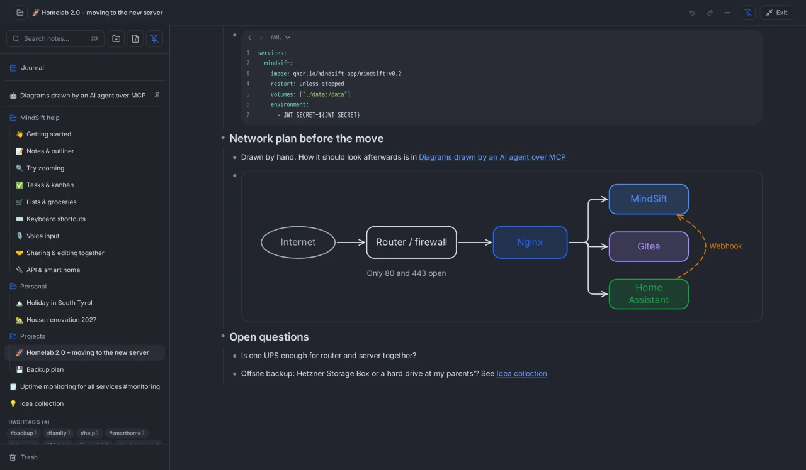
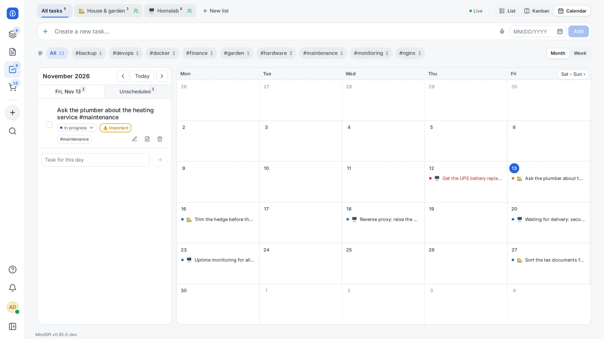

<div align="center">

# 🧠 MindSift
### *Notes, tasks and a clear head, self-hosted.*

[](#quick-start)
[](#quick-start)
[](LICENSE)
[](CHANGELOG.md)

**Nested notes you write together, tasks with a board and a calendar, shared lists, and an inbox for everything that has no place yet.**
One container, one SQLite file, your server.

### [Try the live demo](https://demo.mindsift.app) &nbsp;·&nbsp; [Website](https://mindsift.app/en/) &nbsp;·&nbsp; [Quick start](#quick-start)

<sub>Demo login: <code>admin</code> / <code>admin</code> (or <code>user</code> / <code>user</code> in a second window to see live collaboration). It resets every 20 minutes, so break whatever you like.</sub>

<p align="center">
  
</p>

</div>

---

> ### 👋 Hey, before you scroll
>
> Yes, this was coded with a *lot* of AI help. No, that doesn't make it slop. I've put many, many evenings into it: deciding what goes in and what doesn't, testing every screen on my phone on the bus, ripping things out again and nitpicking pixels until it felt right. The robot typed, I argued with it.
>
> Credit where it's due: none of this came out of thin air. The idea is a remix of every outliner, kanban board and shopping list app I've ever loved (and a few I rage-quit), and the code stands on the shoulders of thousands of open-source developers whose work taught the models how to write it. So really, this is a big thank-you note with a login screen. 🙏
>
> It's free, and it stays free. Use it, fork it, host it for your family. If something's broken, open an issue. If you like it, a ⭐ makes my day. And if you hate it… please don't. Just close the tab. 😅

---

## What's inside

### 📝 Outliner notes, together, live
Every thought is a bullet: indent, collapse, zoom in, drag whole branches. Wiki links (also to single bullets, and they survive renaming or moving a note), hashtags, slash commands, code blocks, tables, images, voice notes, dictation, link previews and hidden values (`/secret` for an IP or a token: stored encrypted, shown only on a tap, never to API keys or AI agents). Several people write in the same note at once without overwriting each other, offline and behind strict proxies too. A public link shows a note to outsiders: read only, optionally with a password, always expiring, kept out of search engines.

Drawings in a note (`/canvas`): shapes, arrows that dock to them, text and freehand; several people can draw in one drawing at once and see each other's pointers, others watch live; AI agents can draw flowcharts and mind maps from Mermaid. Focus mode hides everything but the note.

<p align="center">
  
</p>

### ✅ Tasks, kanban & calendar
List, board and calendar (month or week, with a column of unscheduled tasks to drag onto a day), with your own columns, priorities, due dates, subtasks, recurring tasks and undo. Share task lists, mention people with @, watch tasks or mute a busy list, and get alarms and a daily summary by email, push, Discord or webhook.

A to-do in a note can be kept as a full task with due date, column and alarm; checkmark, title and subtasks stay in sync in both places. "Expand as a note" gives a task a note of its own, and the "To-dos" tab collects the open checkboxes of all your notes.

<p align="center">
  
</p>

<p align="center">
  
</p>

### 📅 Journal
One note per day, all days below each other, with a calendar to jump around (dots mark the days you wrote on). Every day is an ordinary note you can share, search and link to; empty days disappear by themselves. It can be switched off per device.

<p align="center">
  
</p>

### 🛒 Shared lists
Shopping, packing and checklists with quantities and categories by hashtag (`oat milk #fridge`). Tick something off at the supermarket and it's gone on everyone's phone right away.

<p align="center">
  
</p>

### ⚡ Quick capture & triage
Capture a thought without picking a folder: the input bar (`C` or `/`), voice input (in the browser or through your own Whisper server), your phone's share menu or the API. Everything lands in an inbox, and the swipe-style triage empties it later, one card at a time: a key (`H`/`L`, arrows) or a swipe discards a card or turns it into a task, a note or a list item.

<p align="center">
  
</p>

### 🎨 Looks & app
Five colour families, each light and dark, your own accent colour, round or square corners, and your own CSS in the theme manager. Installable as an app (PWA) on phone and desktop, starts offline, with push notifications. In English, German, Spanish, French and Italian, mails and notifications included.

<p align="center">
  
  &nbsp;&nbsp;
  
</p>

<table>
  <tr>
    <td align="center"><br /><sub><b>Fjord</b></sub></td>
    <td align="center"><br /><sub><b>Terracotta</b></sub></td>
  </tr>
  <tr>
    <td align="center"><br /><sub><b>Polarized</b></sub></td>
    <td align="center"><br /><sub><b>Suri</b></sub></td>
  </tr>
</table>

### 🤖 AI agents, API & smart home
MindSift is an **MCP server**: Claude, ChatGPT, Codex, Cursor and your own agents can read and manage your tasks, lists and notes. claude.ai and ChatGPT connect via OAuth, no key needed. A REST API with scoped keys serves Home Assistant, scripts and webhooks. Whatever a key creates or changes carries a badge with its name, so you can tell what an agent did.

```bash
claude mcp add --transport http mindsift https://your-server/api/v1/mcp --header "X-API-Key: mindsift_sec_…"
```

### 🏢 Users & admin
Guided setup, sign-in through Authentik, Authelia, Keycloak or any other OpenID Connect provider, invite codes and links, registration modes (closed, approval, email domains, open), organizations that decide who may share with whom (a person can be in several), groups, sharing as editor or read-only, a user manager role for accounts without the server settings, and automatic backups with restore.

**More on the [website](https://mindsift.app/en/), or [open the demo](https://demo.mindsift.app) and poke around.**

---

## How it compares

MindSift sits between a notes app and a task manager. If one of these fits you better, use it; they are good.

* **[Obsidian](https://obsidian.md):** Markdown files on your own disk, native apps and a huge plugin ecosystem. It is an app, not a server: no web version, and writing in the same note at the same time is not built in. MindSift is a server with a web app; it keeps notes in a database and exports them as Markdown (an Obsidian vault) whenever you ask.
* **[Logseq](https://logseq.com):** the closest relative on the notes side, a local-first outliner with backlinks, queries, a graph view and plugins, and much deeper there than MindSift. MindSift's outliner is simpler, but it runs on your server, is shared with other people and comes with tasks, lists and alarms.
* **[Vikunja](https://vikunja.io):** the more complete self-hosted task manager, with Gantt and table views, CalDAV and a choice of databases, but no notes. MindSift's tasks are tied to notes, with fewer integrations.
* **[Joplin](https://joplinapp.org):** a mature notes app with native apps everywhere, end-to-end encryption and a web clipper. A note is one Markdown document rather than an outline, and two people do not write in it at the same moment. MindSift has none of those three strengths; it has live collaboration and tasks.

If something here is out of date or unfair, please open an issue.

---

## Not (yet) in MindSift

* **SAML, LDAP and logging out at the provider:** single sign-on is OpenID Connect only, and signing out of MindSift does not sign you out of the provider.
* **Passkeys without a fixed https address:** passkeys need `BASE_URL` with https (or `http://localhost`); on a bare IP address or plain http only the authenticator app works.
* **PostgreSQL or MySQL:** SQLite on purpose (see [design decisions](#design-decisions)).
* **CalDAV or an iCal feed:** the calendar exists only inside MindSift.
* **Native apps:** it is a PWA (installable, offline, push), not in the app stores.
* **End-to-end encryption:** the server reads your data, because search, sharing and AI agents need it; only hidden values (`/secret`) are encrypted in the database. Protect the server and its disk.
* **Backups to S3 or WebDAV:** backups go to `data/backups/`; copying them elsewhere is up to you.
* **A Helm chart:** Docker Compose only.
* **Time zones per person:** one time zone per server, not per person (Administration → Server, or `TZ`).

More ideas and the known weak spots: [Doku/flaws.md](Doku/flaws.md).

---

## Quick start

One container with web server, API, database and frontend, for amd64 and arm64 (also a Raspberry Pi with a 64-bit system, Apple Silicon and ARM cloud servers).

**Docker Compose:**

```yaml
services:
  mindsift:
    image: ghcr.io/mindsift-app/mindsift:stable   # the latest tagged release
    restart: unless-stopped
    ports: ["8080:8080"]
    volumes: ["./data:/data"]
    environment:
      - BASE_URL=https://mindsift.example.com
      # Optional: create the admin on the first start instead of in the setup wizard
      # - ADMIN_USER=admin
      # - ADMIN_PASSWORD=...
```

Open `http://localhost:8080`. Without `ADMIN_USER` and `ADMIN_PASSWORD`, a setup wizard creates the admin account. It asks for a one-time setup code that MindSift writes to its log on start (`docker logs mindsift | grep 'Setup code'`), so only someone who can read the server's log becomes its admin; a restart makes a new code, and it stops working once the admin exists.

**Or the install script** ([read it first](install.sh)):

```bash
curl -fsSL https://raw.githubusercontent.com/mindsift-app/mindsift/main/install.sh | bash
```

It generates the secrets, takes over the server's time zone, asks for the admin account and optionally adds a Whisper container for voice input and a reverse proxy network; running it again updates and keeps your settings. Details: [Doku/operations.md](Doku/operations.md#install-script).

All settings are explained in [`.env.example`](.env.example).

**Without a container:** the [releases](https://github.com/mindsift-app/mindsift/releases) carry the server as a single file for Linux (amd64 and arm64), frontend included. Start `./mindsift`: it listens on port 8080 and keeps everything in `./data`. The time zone is not taken from the system but from `TZ` or the administration (UTC until one is set).

---

## Running it

The most important settings (all of them are in [`.env.example`](.env.example); more on running it in [Doku/operations.md](Doku/operations.md)):

| Variable | Default | What for |
|---|---|---|
| `BASE_URL` | `http://localhost:8080` | Public URL; needed for links in mails (password reset), OAuth for claude.ai/ChatGPT and passkeys (these need https, or `http://localhost`, and a host name, not an IP address; the passkeys are bound to this host) |
| `ADMIN_USER`, `ADMIN_PASSWORD`, `ADMIN_EMAIL` | empty | First administrator, created on the first start (see below) |
| `JWT_SECRET` | generated (`/data/jwt.secret`) | Signing key for sign-ins, at least 32 characters (`openssl rand -hex 32`). Shorter values and published examples are ignored. Changing it signs everyone out |
| `SECRETS_KEY` | generated (`/data/secrets.key`) | Key for hidden values (`/secret`); set it to keep it apart from the database. Never change it once values are stored |
| `DEFAULT_LANGUAGE` | `de` (demo: `en`) | `de`, `en`, `es`, `fr` or `it`, see "Language" below |
| `TZ` | `UTC` | Time zone of the server for due dates, alarms, the daily summary and backups; the admin center can set it instead (its setting wins) |
| `REGISTRATION_MODE` | admin UI decides | `closed`, `approval`, `domain`, `domain+approval` or `open` |
| `SMTP_HOST`, `SMTP_PORT`, `SMTP_USER`, `SMTP_PASS`, `SMTP_FROM` | empty | Mail for alarms, invites and password reset (also in the admin UI) |
| `OIDC_ISSUER`, `OIDC_CLIENT_ID`, `OIDC_CLIENT_SECRET` | empty | Sign-in through an OpenID Connect provider, see [single sign-on](#single-sign-on-oidc) below; more options in [Doku/oidc.md](Doku/oidc.md#setup) |
| `TRUSTED_PROXIES` | `private` | Whose `X-Forwarded-For` to trust, see [reverse proxy](Doku/reverse-proxy.md) |
| `MCP_ENABLED` | admin UI decides | `false` switches off the endpoint for AI agents |
| `METRICS_TOKEN` | empty | Switches on `/metrics` for Prometheus, see [monitoring](Doku/operations.md#monitoring) |
| `STT_*` | empty | Your own Whisper server for voice input |
| `MINDSIFT_DEMO` | `false` | Demo accounts `admin/admin` and `user/user` with sample data. **Never on a server with real data!** |

* **First admin:** with `ADMIN_USER` and `ADMIN_PASSWORD` (at least 8 characters, or `ADMIN_PASSWORD_FILE`), the admin exists before the server accepts connections; unusable values stop the start with a reason in the log. They act only while the database has no account ([details](Doku/operations.md#first-admin)).
* **Language:** the app follows the browser if it speaks that language, and everyone can pick their own. `DEFAULT_LANGUAGE` covers the rest; unset, it is German, so for an English instance set `en` or pick it in the setup wizard.
* **Reverse proxy:** pass through WebSocket upgrades and unbuffered SSE if you can; otherwise MindSift falls back to long polling. Examples for nginx, Traefik, Caddy and Cloudflare: [Doku/reverse-proxy.md](Doku/reverse-proxy.md).
* **Backups:** the setup wizard offers daily backups (preselected: 03:00 server time, kept 3 days). Each run saves the whole database plus one ZIP per person under `data/backups/`; copy that folder somewhere else too.
* **Updates:** `docker compose pull && docker compose up -d`. The database schema updates itself; with `user:` in the compose file, run `chown -R 1000:1000 data` first (the container runs as uid 1000 since v0.87.3).
* **Rolling back:** before an update changes the database schema, MindSift saves a compressed copy of the database as `data/backups/system/pre-migration-<migration>-<date>-<time>.db.gz` (the last three are kept; without the copy, for example on a full disk, it does not migrate and stops). An older image refuses to start on a database a newer one has changed and says so in the log. To go back: stop the container, unpack the copy from before the update over the database (`gunzip -c data/backups/system/pre-migration-….db.gz > data/mindsift.db`) and delete `data/mindsift.db-wal` and `data/mindsift.db-shm` if they exist, pin the older image (`image: ghcr.io/mindsift-app/mindsift:vX.Y.Z`) and start it. Whatever was written after the update is not in that copy.
* **Health and monitoring:** the image checks `/api/v1/health` every 30 s (Podman ignores that; copy the `healthcheck:` block of `docker-compose.yml`). `METRICS_TOKEN` switches on Prometheus metrics at `/metrics` ([scrape config and details](Doku/operations.md#monitoring)).
* **File permissions:** everything in `data/` is readable by MindSift only; without the container, run `chmod -R go-rwx data`.
* **Image tags:** `:stable` = the latest release (default), `:vX.Y.Z` = one release, `:latest` = every build of `main`, `:dev` = development. The project is 0.x: the [changelog](CHANGELOG.md) marks breaking changes with **Attention**.

### Single sign-on (OIDC)

With an OpenID Connect provider (Authentik, Authelia, Keycloak, Dex, Google and others) the login shows "Sign in with …". Register MindSift there as a confidential client with the redirect URI **`<BASE_URL>/api/v1/auth/oidc/callback`**, set `BASE_URL` and the three `OIDC_*` variables from the table above. Accounts are tied to the provider's identity, never taken over by email address; `OIDC_PASSWORD_LOGIN=false` leaves only the provider's button (administrators keep an emergency access). All options, edge cases and examples for Authentik, Authelia and Keycloak: [Doku/oidc.md](Doku/oidc.md).

---

## Your data is yours

No telemetry, no third-party services; fonts and icons ship with the app. The server only connects out for what you use: notifications (SMTP, Discord, your webhook, the browsers' push services), link previews (switchable per device) and your own Whisper server. Everything lives in one SQLite file, media next to it in `data/media/`. Export the whole workspace as Markdown (an Obsidian vault) whenever you want; every backup ZIP has that vault inside too, so your data stays readable in Obsidian or any text editor, even without MindSift.

---

## How it is built and checked

MindSift is written with a lot of AI help (see the note at the top). One person decides what goes in and tries it on real devices. What keeps the code honest is that it gets checked:

* **Tests:** more than 650 frontend tests and more than 450 backend tests run before every push and again in the build of every release. If one fails, no image is published.
* **Browser tests:** more than a dozen runs with over 250 checks cover what is hard to unit-test: two people editing the same note at once, offline and back online, sharing, locks and conflict copies, tables, copy & paste as Markdown in Chromium and Firefox, live drawing, two-factor sign-in, passkeys, sign-in through an OpenID Connect provider (against Dex) and connections behind proxies that block WebSockets ([e2e/](e2e/README.md)). They run before every release and every change to these areas.
* **Static checks:** TypeScript, ESLint, gofmt, `go vet` and [golangci-lint](https://golangci-lint.run) with its standard linters (staticcheck among them) ([.golangci.yml](.golangci.yml)), in the same run as the tests.
* **Security:** a review of the whole code base in November 2026 (v0.94.0), findings fixed ([Security](#security)); OIDC, two-factor sign-in and passkeys came later and have their own browser tests; every tagged release is scanned with Trivy ([Security scan](#security-scan)).

History starts at v0.70.0, when the project moved from a private repository; the [changelog](CHANGELOG.md) and its [archive](CHANGELOG-archive.md) go back to 0.1.

---

## Design decisions

The short version; what each decision costs is in [Doku/architecture.md](Doku/architecture.md#design-decisions):

* **One process, one SQLite file:** nothing to run besides the container, and a backup is a file copy. No cluster, no PostgreSQL.
* **Own note sync instead of Yjs or Automerge:** the server has to understand a note (rights, search, backlinks, Markdown), and sync has to survive proxies that cut WebSockets, where Yjs did not hold up. Every change is a plain HTTP request against an operations log. The price: two people cannot type in the same bullet at once.
* **Own OAuth and MCP server:** claude.ai and ChatGPT only connect through OAuth issued by the MCP server itself (discovery, dynamic client registration, PKCE), and MCP over HTTP is four JSON-RPC methods.
* **Own drawing layout:** agents hand in Mermaid, and the server turns it into drawings you can keep editing.
* **Two chunks:** the sign-in page needs less than 220 kB compressed, the app less than 250 kB more after signing in. The service worker loads everything when it installs, so the installed app works offline once it has been opened.
* **Few dependencies:** about a dozen direct Go modules (router, SQLite, WebSocket, JWT, web push, OIDC, WebAuthn and parts of `x/`) and a handful of npm packages at runtime.
* **Grown rather than designed:** a session is a signed token plus a database row plus a version counter. A random session ID would do the same with less; it works and is tested, so it stays for now.

---

## Performance on 1 CPU core and 1 GB RAM

Load-tested with v0.95.0 on the public demo, a deliberately small server with **1 CPU core and 1 GB RAM**, with simulated people signing in, typing in notes, working with tasks and lists and searching at the same time:

| People working at once | Typical answer (median) | Slowest 5 % | Errors |
|---|---|---|---|
| 200, about 10 per note | ~0.05 s | ~0.2 s | 0 % |
| 300, about 10 per note | ~0.1–0.3 s | ~0.6–1.1 s | 0 % |
| 500–800, about 10 per note | ~0.6–1.7 s | ~3–7 s | 0 % |
| 1,200, about 10 per note | ~1.8 s | ~6.5 s | 0 % |
| 200, all in the **same** note | ~0.3–1.3 s for an edit | ~2–3 s | 0 % |
| 300, all in the **same** note | ~6 s for an edit | ~7–8 s | 0 % |

About 300 people at the same moment run smoothly on that single core; above that the CPU is the limit and everything slows down evenly instead of failing. Hundreds typing in the *same* note wait for each other, because edits to one note are applied one after another. More: [Doku/performance.md](Doku/performance.md).

---

## Security

MindSift is meant to be reachable from the internet behind a reverse proxy. The whole code base was reviewed for security in November 2026 (v0.94.0) and the findings are fixed; OIDC, two-factor sign-in and passkeys came later and have their own browser tests. In brief (details in [Doku/security.md](Doku/security.md)):

* **Sign-in:** bcrypt passwords, optional or required two-factor sign-in (authenticator app, passkeys, recovery codes) and server-side sessions you can end one by one. Failed sign-ins lock the account and the address for 15 minutes.
* **Secrets never in plain text:** API keys, tokens and links are stored only as SHA-256 hashes. Hidden values in notes are encrypted with AES-256-GCM under a key kept apart from the database (`SECRETS_KEY`).
* **Rights checked on every request:** every call resolves the caller's role on that note, folder or list; API keys reach only what their scopes allow. Public links are read-only and expire after at most 14 days.
* **Addresses stay private:** others never see e-mail addresses. Mail goes only to confirmed addresses, so the server cannot be used to mail strangers.
* **Browser hardening:** HSTS, a strict Content Security Policy and uploads recognised by their content (no SVG, no scripts). Profile pictures are never loaded from other servers.
* **Nothing reaches into your network:** every address the server contacts (webhooks, push, link previews) is checked against localhost, cloud-metadata and private ranges, also after DNS and redirects. `X-Forwarded-*` headers only count from trusted proxies.
* **Limits and quiet logs:** request bodies, realtime connections and imports are capped. Tokens and typed sign-in names stay out of the log, and errors reveal nothing about the database or files.
* **Supply chain:** the image runs as an unprivileged user. `govulncheck` and `npm audit` report no vulnerability reachable from the code (November 2026).

Found something? Please follow [SECURITY.md](SECURITY.md).

---

## Security scan

[](https://github.com/mindsift-app/mindsift/actions/workflows/security-scan.yaml)

Every tagged release is scanned with [Trivy](https://trivy.dev) before it is published; a fixable high or critical vulnerability or a leaked secret stops it. The published `:stable` and `:latest` are scanned again every week, and the badge shows the last run. Base images, why a missing `USER` line is intended, and how to check the built-in SQLite: [Doku/security.md](Doku/security.md#security-scan).

```bash
docker run --rm aquasec/trivy image ghcr.io/mindsift-app/mindsift:stable
```

---

## Development

Go 1.27 and Node 26 (the active LTS).

```bash
go vet ./cmd/... ./internal/... && go test ./cmd/... ./internal/...   # backend
cd frontend && npm ci
npm run dev                        # Vite dev server
npx tsc --noEmit && npm run test:run
cd .. && ci/local-checks.sh        # all checks at once in containers (podman), with gofmt and staticcheck
e2e/run.sh                         # browser tests (Playwright) against a fresh image
e2e/screenshots.sh                 # recreate the screenshots in this README
```

The multi-stage `Dockerfile` builds the frontend, embeds it into the Go binary and runs all checks. **Stack:** Go (chi, gorilla/websocket, modernc SQLite) · React 19, TypeScript, Vite, Tailwind.

Technical documentation: [Doku/](Doku/README.md) (architecture, database, REST and realtime API, collaboration, permissions, themes). Known weak spots: [Doku/flaws.md](Doku/flaws.md). Want to help? Read [CONTRIBUTING.md](CONTRIBUTING.md) first.

---

## License

MindSift is free software under the [GNU Affero General Public License v3.0](LICENSE): use it, change it, pass it on, even commercially. If you hand out a changed version or run it as a service on the net, its source has to be available under the same license. No warranty.

The licenses of the third-party software built into MindSift (npm packages and Go modules) are in `THIRD_PARTY_LICENSES.txt`, generated at build time: in the image at `/app/THIRD_PARTY_LICENSES.txt` and next to the binary in every release archive. The app links it under *About MindSift* (`/third-party-licenses.txt`).

<div align="center">

**[Try the demo](https://demo.mindsift.app)** · **[mindsift.app](https://mindsift.app/en/)**

<sub>Built for clarity, speed and owning your own stuff. With love, stolen ideas and a robot.</sub>

</div>
